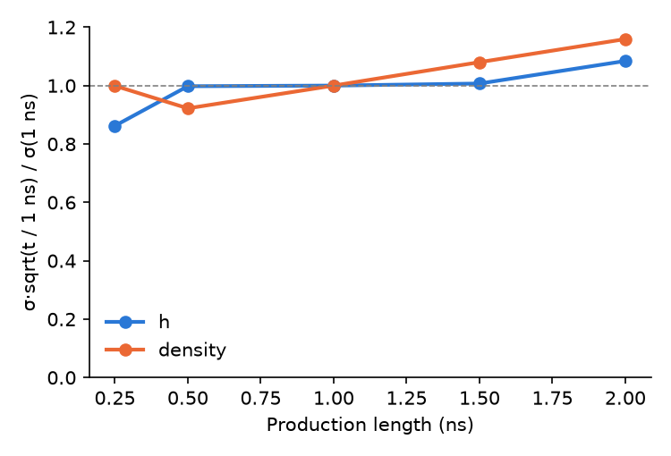
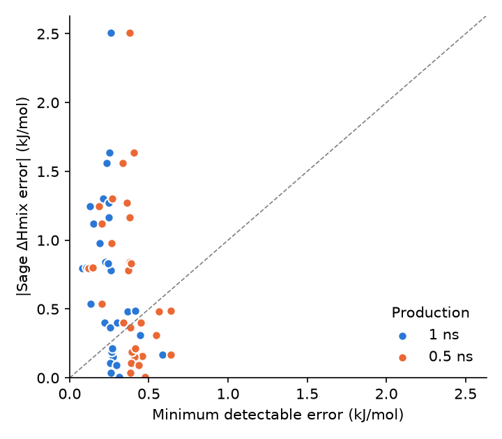

# Power analysis: details

Generated 2026-11-09 by `power_analysis.py`. Summary: [report.md](report.md). Tables: `box_noise.csv`, `truncation.csv`, `points.csv`, `metrics.csv`, `bootstrap.csv`, `allocation.csv`, `equilibration.csv`, `thresholds.csv`, `literature.csv`.

## Method

1. **Run length.** Every Sage run is re-analysed with the benchmark's estimator (`mixing.observables` and `timeseries.estimate_mean`, as in `summarise-sage`), keeping 0.25, 0.5, 1, 1.5, 2 ns of production after 0.1 or 0.2 ns of equilibration. The analysis at the protocol length (1 ns) reproduces the Sage `runs.csv` exactly (tested).
2. **Single-run noise per box.** σ = k·sem, with sem the RMS within-run standard error over the 5 replicates and k the pooled ratio of replicate SD to within-run sem over all boxes at that length (k = 1.11 to 1.20 for h, 1.00 to 1.23 for density). This is smoother than the 5-replicate SD of each box and corrects the within-run sem for the slow modes it misses.
3. **Points.** ΔHmix and V^E are linear in the box means (ml-peg's `mixing_matrix`). Each pure box feeds all three compositions of its system, so noise is drawn per box and propagated, which keeps the correlation between points. The propagated ΔHmix noise at 1 ns (RMS over points 0.099 kJ/mol) matches the observed SD of Sage's replicate ΔHmix (RMS 0.108 kJ/mol, Sage `points.csv`).
4. **Metrics.** For each run length, 20000 draws of one run per box give the noise of every metric for a model whose true errors are 1, 0.5, 0.25, 0 × Sage's (replicate mean minus experiment). Two models run independently, so their metrics differ by noise with SD sqrt(2)·SD(metric). The **resolvable difference** is 2.80·sqrt(2)·SD(metric): a true difference that size is detected at the two-sided 5 % level 80 % of the time. A closed form sqrt(sᵀCs)/N (s the signs of the errors over σ_ref for MAZE, C the point covariance) is given as a check; it holds when errors are well above the noise.
5. **System choice.** A cluster bootstrap over systems (20000 resamples of the 10 mixtures, or of the 19 pure liquids) of Sage's noiseless metric measures how much the metric depends on which systems were picked.

## 1. Noise against run length

Single-run noise × sqrt(t / 1 ns), RMS over boxes and relative to 1 ns. A flat line would mean σ ∝ 1/sqrt(t). For h the scaled noise grows by 9% from 0.5 to 2 ns: short runs miss some slow fluctuations, so cutting the run length costs a little less precision than 1/sqrt(t) predicts.

| Production (ns) | σ ΔHmix (kJ/mol) | σ density (g/mL) | σ V^E (cm³/mol) | σ pure density (g/mL) | k (h) | k (density) |
|---|---|---|---|---|---|---|
| 0.25 | 0.162 | 0.00186 | 0.208 | 0.00159 | 1.13 | 1.13 |
| 0.5 | 0.136 | 0.00122 | 0.139 | 0.00110 | 1.20 | 1.00 |
| 1 | 0.089 | 0.00088 | 0.109 | 0.00087 | 1.13 | 1.07 |
| 1.5 | 0.072 | 0.00080 | 0.095 | 0.00075 | 1.11 | 1.15 |
| 2 | 0.064 | 0.00075 | 0.088 | 0.00071 | 1.15 | 1.23 |

Median single-run noise per point. k is the replicate SD / within-run sem ratio (1 if the within-run sem were right).

## 2. A model against experiment, per point

Minimum detectable error MDE = 2.80·sqrt(σ_sim² + σ_exp²): an error that size is significant at the 5 % level 80 % of the time. The fraction column shows how many of Sage's errors (a realistic model) exceed the MDE. Experimental errors are 4 to 6× smaller than the simulation noise (median σ_sim over median σ_exp, ΔHmix and density) and barely change these limits.

| Property | Production (ns) | Median MDE | Max MDE | Sage errors above MDE | Median σ_exp | Unit |
|---|---|---|---|---|---|---|
| ΔHmix | 0.5 | 0.384 | 0.64 | 53% | 0.014 | kJ/mol |
| ΔHmix | 1 | 0.254 | 0.585 | 67% | 0.014 | kJ/mol |
| ΔHmix | 2 | 0.187 | 0.529 | 70% | 0.014 | kJ/mol |
| Mixture density | 0.5 | 0.00354 | 0.00503 | 81% | 0.0002 | g/mL |
| Mixture density | 1 | 0.00271 | 0.00386 | 85% | 0.0002 | g/mL |
| Mixture density | 2 | 0.0023 | 0.00355 | 89% | 0.0002 | g/mL |
| V^E | 0.5 | 0.389 | 0.799 | 33% | 0.0041 | cm³/mol |
| V^E | 1 | 0.304 | 0.529 | 33% | 0.0041 | cm³/mol |
| V^E | 2 | 0.246 | 0.459 | 44% | 0.0041 | cm³/mol |
| Pure density | 0.5 | 0.00318 | 0.00624 | 95% | 0.00015 | g/mL |
| Pure density | 1 | 0.00252 | 0.00507 | 95% | 0.00015 | g/mL |
| Pure density | 2 | 0.00214 | 0.00417 | 95% | 0.00015 | g/mL |

ΔHmix points above the diagonal have a Sage error that one run per box detects.

## 3. Ranking two models

Metric noise for a Sage-like model (SD of the score over repeat benchmark runs), the resolvable difference over all error profiles, and the SD of Sage's score over the choice of systems. Units as in the thresholds table of [report.md](report.md).

| Metric | SD (1 ns) | SD closed form | Resolvable (1 ns) | Resolvable (2 ns) | SD over systems |
|---|---|---|---|---|---|
| ΔHmix MAE | 0.021 | 0.023 | 0.047 to 0.083 | 0.038 to 0.067 | 0.17 |
| ΔHmix MAZE | 0.2 | 0.21 | 0.44 to 0.8 | 0.34 to 0.6 | 2.1 |
| Mixture density MAE | 0.00018 | 0.00018 | 0.00044 to 0.00071 | 0.00035 to 0.00057 | 0.0033 |
| Mixture density MAZE | 0.2 | 0.2 | 0.47 to 0.77 | 0.38 to 0.63 | 3.5 |
| V^E MAE | 0.025 | 0.029 | 0.058 to 0.098 | 0.048 to 0.083 | 0.088 |
| V^E MAZE | 0.23 | 0.27 | 0.54 to 0.92 | 0.45 to 0.77 | 1.1 |
| Pure density MAE | 0.00022 | 0.00022 | 0.00054 to 0.00089 | 0.00045 to 0.00073 | 0.0015 |
| Pure density MAZE | 0.23 | 0.24 | 0.56 to 0.92 | 0.47 to 0.77 | 1.9 |

Noise also biases each score upwards, most for good models: a model whose true ΔHmix MAE is 0.17 kJ/mol scores 0.20 on average at 1 ns, against 0.71 for a true 0.70. Differences between good models are slightly compressed, but their order is kept.

The two kinds of uncertainty answer different questions. The simulation noise says whether rerunning the benchmark would give the same ranking on these 10 systems; at 1 ns it would, for any gap above the resolvable difference. The system spread says how far a model's score depends on this set of systems, which no run length can reduce.

For a ranking, what matters is the system spread of the *difference* between two models, which depends on how alike their errors are. If model B's errors are model A's scaled by (1 + s), the gap is s·MAE_A and its system SD is s·0.17, i.e. 0.24× the gap at any size, so the choice of systems never threatens that ranking. If their errors are unrelated, the gap's system SD approaches sqrt(2)·0.17 = 0.24 kJ/mol, and gaps below about twice that are specific to this set of systems even though a rerun would reproduce them. Real model pairs (e.g. two sizes of one model family) are likely to sit between these cases.

## 4. Run length and cost

| Protocol (ns) | Cost | MACE-OFF23(M) GPU-days | Resolvable ΔHmix MAE (kJ/mol) | Resolvable density MAE (g/mL) | Perfect ΔHmix MAZE |
|---|---|---|---|---|---|
| 0.2 + 0.25 | 38% | 50 | 0.134 | 0.0014 | 1.29 |
| 0.2 + 0.5 | 58% | 77 | 0.115 | 0.0009 | 1.05 |
| 0.2 + 1 | 100% | 133 | 0.083 | 0.0007 | 0.71 |
| 0.2 + 1.5 | 142% | 188 | 0.071 | 0.0006 | 0.58 |
| 0.2 + 2 | 183% | 243 | 0.067 | 0.0006 | 0.52 |

Cost is Σ atoms × simulated time over the 49 boxes (73,031 atoms). GPU-days are an order of magnitude only: MACE-OFF23(M) runs 1.1×10⁶ steps/day for ~600-atom liquid boxes on one A100 ([arXiv:2312.15211](https://arxiv.org/abs/2312.15211), sec. III.3.2), scaled linearly to our 952 to 2,300-atom boxes. Faster and slower models scale the column, not the ratios.

**Equilibration.** The mean over the 100 to 200 ps window minus the mean over the 1 ns production, over all 245 Sage runs, is -0.038 kJ/mol for h (p = 0.005) and +0.0007 g/mL for density (p = 4e-04). Even for Sage, starting from Sage-built boxes, the window is shifted. By replicate, the density shift is -0.0004 (0), +0.0017 (1), +0.0017 (2), +0.0011 (3), -0.0007 (4) g/mL; replicate 0 is the distributed box that MLP runs start from. An MLP also has to relax from Sage's density to its own, which this test cannot see, so 0.2 ns stays. Table: [equilibration.csv](equilibration.csv).

**Per-box run lengths.** For a fixed variance of ΔHmix MAE, mixture density MAE and pure density MAE (equally weighted, each relative to uniform 1 ns), the cheapest allocation runs each box for t ∝ sqrt(A_b / n_b), where A_b is the box's variance contribution and n_b its atom count, with at least 0.5 ns. It ranges from 0.5 to 2.1 ns ([allocation.csv](allocation.csv)); the longest runs go to pure_1_2_dichloroethane_298, pure_n_methylaniline_298, acetone_nmethylaniline_x230, nmp_dichloroethane_x200. It saves 7% of the cost. That assumes σ ∝ 1/sqrt(t), which section 1 shows is optimistic for short runs, so the real saving is smaller. Not worth the extra complexity.

## 5. Literature: how far apart are current MLPs?

| Model | Property | Result | Source |
|---|---|---|---|
| MACE-OFF23(M) | pure density, 109 organic liquids | MAE 0.09 g/mL | [Kovács et al. 2025](https://doi.org/10.1021/jacs.4c07099), sec. III.3.2 |
| MACE-OFF23(S) | pure density, 109 organic liquids | MAE 0.23 g/mL (systematically too dense) | [Kovács et al. 2025](https://doi.org/10.1021/jacs.4c07099), sec. III.3.2 |
| MACE-OFF23(L) | pure density, 109 organic liquids | no significant improvement over (M) | [Kovács et al. 2025](https://doi.org/10.1021/jacs.4c07099), sec. III.3.2 |
| ANI-2x | pure density, 109 organic liquids | MAE and RMSE about twice MACE-OFF23(M) | [Kovács et al. 2025](https://doi.org/10.1021/jacs.4c07099), sec. III.3.2 |
| MACE-OFF23(M) | ΔHvap, 109 organic liquids | systematic offset of about 2 kcal/mol (8 kJ/mol) | [Kovács et al. 2025](https://doi.org/10.1021/jacs.4c07099), sec. III.3.2 |
| Organic_MPNICE | pure density, 62 solvents | about 4 % mean error (4.9 % in Table 12) | [Weber et al. 2025](https://arxiv.org/abs/2505.06462), sec. 3.1.4 |
| QRNN | pure density, 62 solvents | about 16 % mean error, systematically high | [Weber et al. 2025](https://arxiv.org/abs/2505.06462), sec. 3.1.4 |
| Hybrid / inorganic MPNICE | pure density, 62 solvents | 18 to 35 % mean absolute error | [Weber et al. 2025](https://arxiv.org/abs/2505.06462), Table 12 |
| ANI-2x, MACE-OFF23(S, M) vs CGenFF | density and ΔHvap of 6 liquids (water, methanol, acetone, benzene, hexane, NMA) | the MLPs miss in both directions (e.g. MACE-OFF23(M) too dense for water, too light for acetone and hexane); CGenFF best overall | [Picha et al. 2025](https://doi.org/10.1021/acs.jcim.5c01355) |
| BAMBOO | density of electrolyte solvent mixtures | about 0.01 g/mL average error, after a density alignment step fitted to experiment | [Gong et al. 2025](https://doi.org/10.1038/s42256-025-01009-7) ([arXiv:2404.07181](https://arxiv.org/abs/2404.07181)) |
| UMA-OMol vs SevenNet-OMat, Orb-OMat | density of ether and carbonate electrolytes | UMA-OMol much closer to experiment than models trained on inorganic data (qualitative in the abstract) | [arXiv:2603.20183](https://arxiv.org/abs/2603.20183) |

No study computing ΔHmix or V^E of molecular liquids with an MLP was found (searches of the web and of Consensus for MLP / neural network potential enthalpy of mixing, excess enthalpy and excess volume, October 2026). The closest work concerns metallic alloys ([arXiv:2406.17499](https://arxiv.org/abs/2406.17499)) or fits mixing data without MD.

- **Density.** Published MLPs differ in pure-liquid density MAE by about 0.05 to 0.25 g/mL. The benchmark resolves 0.0007 g/mL at 1 ns and 0.0014 g/mL at 0.25 ns. Density alone could be ranked from much shorter runs, but the runs serve ΔHmix too.
- **ΔHmix.** There is no MLP baseline. MLP ΔHvap errors are several kJ/mol (MACE-OFF23(M) offset about 8 kJ/mol; Picha et al. find large ΔHvap deviations for MACE-OFF23(M)). ΔHmix is a difference of such cohesive energies, so much of that error may cancel, but whatever remains is compared with |ΔHmix| near x = 0.5 of 0.6 to 2.6 kJ/mol. If MLPs differ in ΔHmix MAE by even a fifth of Sage's MAE (about 0.14 kJ/mol), 1 ns resolves it.

## Caveats

- **Sage stands in for MLP noise.** MLP fluctuations of h and volume should be similar (the same liquids at the same T and P), but correlation times may differ, especially for MLPs that change conformer barriers. One pilot MLP run per box, analysed with `mixing.box_result`, would check this: compare its sem and n_eff with the Sage `runs.csv`.
- **Slow modes.** k = 1.13 (h, 1 ns) is pooled over boxes. Single boxes have larger run-to-run spreads (for Sage, NMP + 1,2-dichloroethane; see the [Sage report](../sage_summary/report.md)), and an MLP may have slow modes of its own.
- **Systematic simulation errors** (finite size, starting structures) are not noise and are not included. Against the published 1000-molecule Sage runs, the median ΔHmix gap is 0.037 kJ/mol and the largest 0.11 kJ/mol (acetone_nmethylaniline_x230).
- **Error profiles.** The model pairs are built from Sage's errors. Real MLPs may spread their errors differently; the closed-form SD shows the result depends mainly on the noise, not on the profile.
