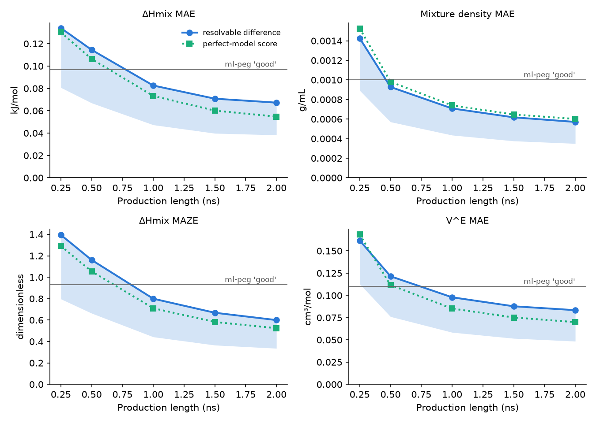

# Power analysis: can one run per box rank MLPs?

Generated 2026-11-09 by `power_analysis.py`. Method, full tables, literature and caveats: [details.md](details.md). Thresholds: [thresholds.csv](thresholds.csv), ready to paste into ml-peg as [metrics_snippet.yml](metrics_snippet.yml).

ml-peg runs every MLP once per box: 0.2 ns of NPT equilibration and 1 ns of production at a 1 fs time step. The 245 Sage runs (49 boxes × 5 replicates, [Sage report](../sage_summary/report.md)) stand in for MLP simulation noise. From them we estimate what one run per box can resolve, what it costs, and where ml-peg's 'good' and 'bad' thresholds should sit.

## Answer

- **Between models.** Two models are told apart (two-sided 5 % test, 80 % power) when their ΔHmix MAE differs by 0.05 to 0.083 kJ/mol, or their mixture density MAE by 0.0004 to 0.0007 g/mL. Published MLPs differ in pure-liquid density MAE by about 0.05 to 0.25 g/mL, about 70 to 400× more.
- **Against experiment.** One run per box detects an error at a single point above 0.25 kJ/mol for ΔHmix and 0.0027 g/mL for density (median over points). 67% of Sage's ΔHmix errors are larger.
- **Cost.** 73,031 atoms over 49 boxes, about 133 MACE-OFF23(M) A100 GPU-days per model (order of magnitude). 0.2 + 2 ns would cost 1.8× as much (about 111 GPU-days more) and narrow the resolvable ΔHmix MAE difference from 0.083 to 0.067 kJ/mol. Per-box run lengths would save only 7%.

We run 0.2 + 1 ns for cost: it already resolves density gaps far smaller than those between published MLPs, and 0.2 + 2 ns would narrow the resolvable ΔHmix MAE difference by only 19% for 1.8× the cost. Equilibration stays at 0.2 ns ([details](details.md#4-run-length-and-cost)).

Blue: resolvable difference for a Sage-like error profile (band: 1 to 0 × Sage's errors). Green: the score a model that matches experiment exactly gets from noise alone. Grey: the 'good' threshold.

## Thresholds

Every property is scored by MAZE (each error divided by a fixed σ_ref = sqrt(σ_Sage² + σ_exp²)), with the MAE shown at weight 0. Thresholds come from the error analysis: **good** is the score of a model that matches experiment exactly, with one run per box, plus 2 SD of its noise, so such a model scores 'good' about 98 % of the time. **Bad** is 5× Sage's score, as Sage was trained on these properties. Mixture and pure densities share one set of thresholds for simplicity, the larger of their two values, so both rules still hold for each.

| Metric | Perfect model (1 ns) | Sage | Good | Bad | Unit |
|---|---|---|---|---|---|
| ΔHmix MAE | 0.073 ± 0.012 | 0.698 | 0.097 | 3.5 | kJ/mol |
| ΔHmix MAZE | 0.71 ± 0.11 | 7.88 | 0.93 | 39 |  |
| Mixture density MAE | 0.00074 ± 0.00011 | 0.0129 | 0.001 | 0.064 | g/mL |
| Mixture density MAZE | 0.80 ± 0.12 | 13.9 | 1.1 | 70 |  |
| V^E MAE | 0.085 ± 0.015 | 0.322 | 0.11 | 1.6 | cm³/mol |
| V^E MAZE | 0.81 ± 0.14 | 3.47 | 1.1 | 17 |  |
| Pure density MAE | 0.00075 ± 0.00014 | 0.0122 | 0.001 | 0.064 | g/mL |
| Pure density MAZE | 0.77 ± 0.14 | 12.5 | 1.1 | 70 |  |

The perfect-model floor depends on the run length (ΔHmix MAZE 0.71 at 1 ns, 0.52 at 2 ns), so the thresholds must be recomputed if the protocol changes.

## Main caveat

Sage stands in for MLP noise. MLP fluctuations of h and volume should be similar (the same liquids at the same T and P), but correlation times may differ, especially for MLPs that change conformer barriers. One pilot MLP run per box, analysed with `mixing.box_result`, would check this: compare its sem and n_eff with the Sage `runs.csv`. Other caveats are in [details.md](details.md#caveats).
