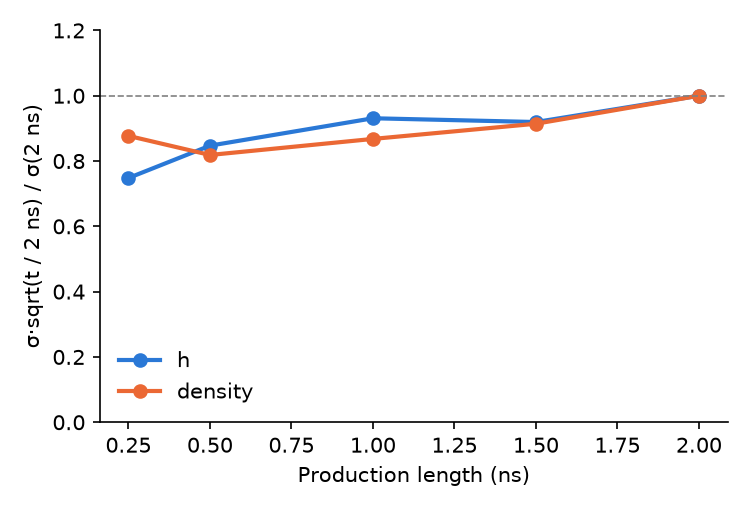
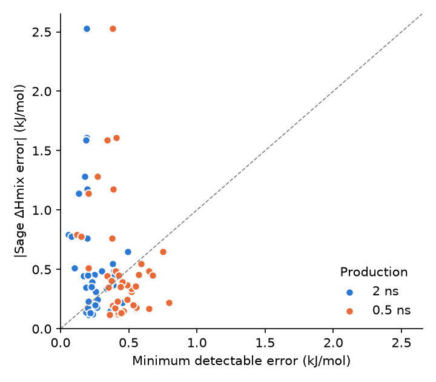
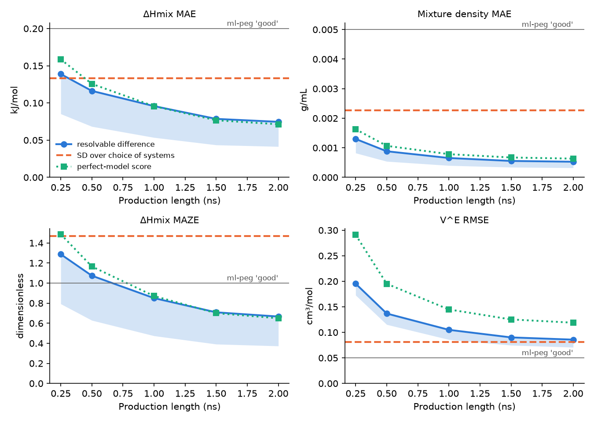

# Can one run per box rank MLPs? (power analysis)

ml-peg runs every MLP once per box: 0.2 ns of NPT equilibration and 2 ns of production at a 1 fs time step. This report asks whether that is enough to tell MLPs apart from each other and from experiment, given the simulation and experimental error bars, and whether shorter runs would do.

The 320 Sage runs (64 boxes × 5 replicates, `data/sage_summary/`) stand in for MLP simulation noise. This assumes an MLP's fluctuations and correlation times are similar to Sage's, which no MLP run has checked yet.

## Summary

- **Simulation noise is small next to the choice of systems.** At 2 ns, the ΔHmix MAE of one model moves by 0.019 kJ/mol (SD) between repeat benchmark runs. Which 13 systems were chosen moves Sage's MAE by 0.13 kJ/mol (cluster bootstrap), 7× more. For mixture density the factor is 17× (0.00013 vs 0.0023 g/mL). How much the choice of systems matters for a *ranking* depends on how alike two models' errors are (section 3).
- **Two models can be told apart** (95 % test, 80 % power) when their ΔHmix MAE differs by 0.04 to 0.075 kJ/mol, or their mixture density MAE by 0.0005 g/mL. Published MLPs differ in pure-liquid density MAE by about 0.05 to 0.25 g/mL (section 6), 100 to 500× more.
- **Against experiment, per point,** one run per box detects a ΔHmix error above 0.22 kJ/mol (median over points; 67% of Sage's errors are larger) and a density error above 0.0023 g/mL. Experimental errors are 5 to 12× smaller than simulation noise (median σ_exp vs σ_sim) and barely change these limits.
- **Two metric thresholds sit below the noise floor.** A perfect model scores 0.119 cm³/mol on V^E RMSE (ml-peg 'good' is 0.05) and 0.65 on ΔHmix MAZE ('good' is 1.0). See section 5.
- **Run length.** Production of 1 ns costs 55% of the current protocol and widens the resolvable ΔHmix MAE difference from 0.075 to 0.096 kJ/mol. Noise falls a little more slowly than 1/sqrt(t), because longer runs sample slow modes that short runs miss. Per-box run lengths optimised for cost save only 17%. Equilibration should stay at 0.2 ns.

## Recommendation

- Keep 0.2 + 2 ns as the default. At that length a rerun reproduces any ranking whose gap exceeds the resolvable difference, and simulation noise is a small part of each metric's uncertainty except for V^E RMSE.
- 0.2 + 1 ns is a reasonable cheaper option (about 158 MACE-OFF23(M) A100 GPU-days saved per model, of 347; see section 4). Decide once MLP pilot runs show whether MLP correlation times match Sage's.
- Do not shorten equilibration: the 100 to 200 ps window is still shifted for Sage (section 4), and an MLP must also relax from Sage's structure to its own density.
- Raise the ΔHmix MAZE and V^E RMSE 'good' thresholds above their noise floors, or bias-correct V^E RMSE (section 5).

## Method

1. **Run length.** Every Sage run is re-analysed with the benchmark's estimator (`mixing.observables` and `timeseries.estimate_mean`, as in `summarise-sage`) keeping 0.25, 0.5, 1, 1.5, 2 ns of production after 0.2 ns of equilibration. The 2 ns analysis reproduces `runs.csv` exactly (tested).
2. **Single-run noise per box.** σ = k·sem, with sem the RMS within-run standard error over the 5 replicates and k the pooled ratio of replicate SD to within-run sem over all boxes at that length (k ≈ 1.2 for h, 1.0 to 1.2 for density). This is smoother than the 5-replicate SD of each box and corrects the within-run sem for the slow modes it misses.
3. **Points.** ΔHmix and V^E are linear in the box means (ml-peg's `mixing_matrix`). Each pure box feeds all three compositions of its system, so noise is drawn per box and propagated, which keeps the correlation between points. The propagated ΔHmix noise at 2 ns (RMS over points 0.098 kJ/mol) matches the observed SD of Sage's replicate ΔHmix (RMS 0.095 kJ/mol, `data/sage_summary/points.csv`).
4. **Metrics.** For each run length, 20000 draws of one run per box give the noise of every benchmark metric for a model whose true errors are 1, 0.5, 0.25 or 0 × Sage's (replicate-mean minus experiment). Two models run independently, so their metrics differ by noise with SD sqrt(2)·SD(metric). The **resolvable difference** is 2.80·sqrt(2)·SD(metric): a true difference that size is detected at the two-sided 5 % level 80 % of the time. For MAE, a closed form sqrt(sᵀCs)/N (s the signs of the errors, C the point covariance) is given as a check; it applies when errors are well above the noise.
5. **System choice.** A cluster bootstrap over systems (20000 resamples of the 13 mixtures, or of the 11 scored pure liquids) of Sage's noiseless metric measures how much the metric depends on which systems were picked.

## 1. Noise against run length

Single-run noise × sqrt(t / 2 ns), RMS over boxes and relative to 2 ns. A flat line would mean σ ∝ 1/sqrt(t). For h the scaled noise grows by about 15 % from 0.5 to 2 ns: short runs miss some slow fluctuations, so cutting the run length costs a little less precision than 1/sqrt(t) predicts. The density line wanders by a similar amount without a trend, which is within the uncertainty of k from 5 replicates.

| Production (ns) | σ ΔHmix (kJ/mol) | σ density (g/mL) | σ V^E (cm³/mol) | σ pure density (g/mL) | k (h) | k (density) |
|---|---|---|---|---|---|---|
| 0.25 | 0.200 | 0.00195 | 0.271 | 0.00170 | 1.18 | 1.23 |
| 0.5 | 0.150 | 0.00129 | 0.183 | 0.00119 | 1.21 | 1.08 |
| 1 | 0.109 | 0.00091 | 0.138 | 0.00094 | 1.19 | 1.11 |
| 1.5 | 0.088 | 0.00081 | 0.118 | 0.00076 | 1.15 | 1.17 |
| 2 | 0.080 | 0.00077 | 0.113 | 0.00071 | 1.19 | 1.27 |

Median single-run noise per point. k is the replicate SD / within-run sem ratio (1 if the within-run sem were right).

## 2. A model against experiment, per point

Minimum detectable error MDE = 2.80·sqrt(σ_sim² + σ_exp²): an error that size is significant at the 5 % level 80 % of the time. The fraction column shows how many of Sage's errors (a realistic model) exceed the MDE.

| Property | Production (ns) | Median MDE | Max MDE | Sage errors above MDE | Median σ_exp |
|---|---|---|---|---|---|
| ΔHmix | 0.5 | 0.4205 | 0.7954 | 38% | 0.0069 |
| ΔHmix | 1 | 0.3062 | 0.6702 | 49% | 0.0069 |
| ΔHmix | 2 | 0.2249 | 0.551 | 67% | 0.0069 |
| Mixture density | 0.5 | 0.003631 | 0.005776 | 69% | 0.00015 |
| Mixture density | 1 | 0.002754 | 0.004321 | 75% | 0.00015 |
| Mixture density | 2 | 0.002319 | 0.003584 | 83% | 0.00015 |
| V^E | 0.5 | 0.514 | 0.866 | 17% | 0 |
| V^E | 1 | 0.3871 | 0.6392 | 17% | 0 |
| V^E | 2 | 0.3179 | 0.5372 | 22% | 0 |
| Pure density | 0.5 | 0.003446 | 0.004244 | 64% | 0.00015 |
| Pure density | 1 | 0.002772 | 0.00409 | 64% | 0.00015 |
| Pure density | 2 | 0.002333 | 0.003977 | 73% | 0.00015 |

Units: kJ/mol (ΔHmix), g/mL (densities), cm³/mol (V^E).

ΔHmix points above the diagonal have a Sage error that one run per box detects.

## 3. Ranking two models

Blue: resolvable difference for a Sage-like error profile (band: all profiles, 1 to 0 × Sage's errors). Orange: SD of Sage's metric over the choice of systems. Green: the score a perfect model gets from noise alone. Grey: ml-peg's 'good' threshold.

| Metric | Sage | SD (sim, 2 ns) | SD closed form | Resolvable (2 ns) | Resolvable (1 ns) | SD over systems | Perfect-model score (2 ns) | ml-peg 'good' |
|---|---|---|---|---|---|---|---|---|
| ΔHmix MAE | 0.5463 | 0.019 | 0.02 | 0.041 to 0.075 | 0.054 to 0.096 | 0.13 | 0.0714 | 0.2 |
| ΔHmix MAZE | 5.374 | 0.17 | 0.18 | 0.37 to 0.67 | 0.47 to 0.85 | 1.5 | 0.65 | 1.0 |
| Mixture density MAE | 0.008612 | 0.00013 | 0.00013 | 0.00032 to 0.00053 | 0.0004 to 0.00066 | 0.0023 | 0.000634 | 0.005 |
| Mixture density MAZE | 10.74 | 0.16 | 0.16 | 0.38 to 0.62 | 0.47 to 0.76 | 3.2 | 0.748 | 3.0 |
| V^E RMSE | 0.3137 | 0.022 | nan | 0.071 to 0.086 | 0.086 to 0.1 | 0.081 | 0.119 | 0.05 |
| Pure density MAE | 0.008469 | 0.00025 | 0.00026 | 0.00061 to 0.001 | 0.00072 to 0.0012 | 0.0019 | 0.000655 | 0.005 |

Noise also biases each score upwards, most for good models: a model whose true ΔHmix MAE is 0.14 kJ/mol scores 0.16 on average at 2 ns, against 0.55 for a true 0.55. Differences between good models are therefore slightly compressed, but their order is kept.

The two kinds of uncertainty answer different questions. The simulation noise says whether rerunning the benchmark would give the same ranking on these 13 systems; at 2 ns it would, for any gap above the resolvable difference. The system spread says how far a model's score depends on this particular set of systems, which no run length can reduce.

For a ranking, what matters is the system spread of the *difference* between two models, which depends on how alike their errors are. If model B's errors are model A's scaled by (1 + s), the gap is s·MAE_A and its system SD is s·0.13, i.e. 0.24× the gap at any size, so the choice of systems never threatens that ranking and simulation noise is the only limit. If their errors are unrelated, the gap's system SD approaches sqrt(2)·0.13 = 0.19 kJ/mol, and gaps below about twice that are specific to this set of systems even though a rerun would reproduce them. Real model pairs (e.g. two sizes of one model family) are likely to sit between these cases.

## 4. Shorter runs

| Protocol (ns) | Cost | MACE-OFF23(M) GPU-days | Resolvable ΔHmix MAE | Resolvable density MAE | Perfect ΔHmix MAZE | Perfect V^E RMSE |
|---|---|---|---|---|---|---|
| 0.2 + 0.25 | 20% | 71 | 0.139 | 0.0013 | 1.49 | 0.291 |
| 0.2 + 0.5 | 32% | 110 | 0.116 | 0.0009 | 1.17 | 0.195 |
| 0.2 + 1 | 55% | 189 | 0.096 | 0.0007 | 0.87 | 0.145 |
| 0.2 + 1.5 | 77% | 268 | 0.079 | 0.0006 | 0.70 | 0.125 |
| 0.2 + 2 | 100% | 347 | 0.075 | 0.0005 | 0.65 | 0.119 |

Cost is Σ atoms × simulated time over the 64 boxes (104076 atoms). GPU-days are an order of magnitude only: MACE-OFF23(M) runs 1.1×10⁶ steps/day for ~600-atom liquid boxes on one A100 ([arXiv:2312.15211](https://arxiv.org/abs/2312.15211), sec. III.3.2), scaled linearly to our 950 to 2,800-atom boxes. Faster and slower models scale the column, not the ratios.

**Equilibration.** The mean over the 100 to 200 ps window minus the mean over the 2 ns production, over all 320 Sage runs:

| Observable | Mean shift | RMS shift | p (mean = 0) |
|---|---|---|---|
| h | -0.04502 | 0.304 | 0.008 |
| density | +0.0007865 | 0.003002 | 2e-06 |

Units: kJ/mol per molecule (h), g/mL (density). Even for Sage, starting from Sage-built boxes, the window is shifted on average, mostly in replicates 1 to 3 (re-packed boxes; density +0.0013 to +0.0016 g/mL) rather than replicate 0, the distributed box that MLP runs start from (-0.0004 g/mL). An MLP also has to relax from Sage's density to its own, which this test cannot see, so 0.2 ns stays.

**Per-box run lengths.** For a fixed variance of ΔHmix MAE, mixture density MAE and pure density MAE (equally weighted, each relative to uniform 2 ns), the cheapest allocation runs each box for t ∝ sqrt(A_b / n_b), where A_b is the box's variance contribution and n_b its atom count, with at least 0.5 ns. It ranges from 0.5 to 4.7 ns (`allocation.csv`): pure water and the small-weight pure boxes get less, slow pure liquids (N-methylaniline, DMAE, pyrrole, THP) more. It saves 17% of the cost. That assumes σ ∝ 1/sqrt(t), which section 1 shows is optimistic for short runs, so the real saving is smaller. Not worth the extra complexity.

## 5. Thresholds below the noise floor

- **V^E RMSE.** A perfect model scores 0.119 cm³/mol at 2 ns (median per-point σ 0.113): V^E is a small difference of molar volumes, and RMSE adds the noise in quadrature. The 'good' threshold of 0.05 cannot be reached. Options: raise 'good' to 0.15; or report a bias-corrected sqrt(max(0, MSE − mean σ_i²)), with σ_i each point's own propagated standard error inflated by k ≈ 1.2.
- **ΔHmix MAZE.** A perfect model scores 0.65 at 2 ns and 0.87 at 1 ns, because σ_ref is close to the single-run noise. The 'good' threshold of 1.0 is barely reachable. Proposal: 'good' = 1.5.
- ΔHmix MAE ('good' 0.2 kJ/mol, floor 0.071), density MAE and MAZE, and pure density MAE are well above their floors.

## 6. Literature: how far apart are current MLPs?

| Model | Property | Result | Source |
|---|---|---|---|
| MACE-OFF23(M) | pure density, 109 organic liquids | MAE 0.09 g/mL | [Kovács et al. 2025](https://doi.org/10.1021/jacs.4c07099), sec. III.3.2 |
| MACE-OFF23(S) | pure density, 109 organic liquids | MAE 0.23 g/mL (systematically too dense) | [Kovács et al. 2025](https://doi.org/10.1021/jacs.4c07099), sec. III.3.2 |
| MACE-OFF23(L) | pure density, 109 organic liquids | no significant improvement over (M) | [Kovács et al. 2025](https://doi.org/10.1021/jacs.4c07099), sec. III.3.2 |
| ANI-2x | pure density, 109 organic liquids | MAE and RMSE about twice MACE-OFF23(M) | [Kovács et al. 2025](https://doi.org/10.1021/jacs.4c07099), sec. III.3.2 |
| MACE-OFF23 | ΔHvap, 109 organic liquids | systematic offset of about 2 kcal/mol (8 kJ/mol) | [Kovács et al. 2025](https://doi.org/10.1021/jacs.4c07099), sec. III.3.2 |
| Organic_MPNICE | pure density, 62 solvents | about 4 % mean error (4.9 % in Table 12) | [Weber et al. 2025](https://arxiv.org/abs/2505.06462), sec. 3.1.4 |
| QRNN | pure density, 62 solvents | about 16 % mean error, systematically high | [Weber et al. 2025](https://arxiv.org/abs/2505.06462), sec. 3.1.4 |
| Hybrid / inorganic MPNICE | pure density, 62 solvents | 18 to 35 % mean absolute error | [Weber et al. 2025](https://arxiv.org/abs/2505.06462), Table 12 |
| ANI-2x, MACE-OFF23(S, M) vs CGenFF | density and ΔHvap of 6 liquids (water, methanol, acetone, benzene, hexane, NMA) | the MLPs miss in both directions (e.g. MACE-OFF23(M) too dense for water, too light for acetone and hexane); CGenFF best overall | [Picha et al. 2025](https://doi.org/10.1021/acs.jcim.5c01355) |
| BAMBOO | density of electrolyte solvent mixtures | about 0.01 g/mL average error, after a density alignment step fitted to experiment | [Gong et al. 2025](https://doi.org/10.1038/s42256-025-01009-7) ([arXiv:2404.07181](https://arxiv.org/abs/2404.07181)) |
| UMA-OMol vs SevenNet-OMat, Orb-OMat | density of ether and carbonate electrolytes | UMA-OMol much closer to experiment than models trained on inorganic data (qualitative in the abstract) | [arXiv:2603.20183](https://arxiv.org/abs/2603.20183) |

No study computing ΔHmix or V^E of molecular liquids with an MLP was found (searches of the web and of Consensus for MLP / neural network potential enthalpy of mixing, excess enthalpy and excess volume, October 2026). The closest work concerns metallic alloys ([arXiv:2406.17499](https://arxiv.org/abs/2406.17499)) or fits mixing data without MD. For comparison, Sage's ΔHmix MAE on this set is 0.55 kJ/mol (`data/sage_summary/sage_report.md`).

**What this means for the benchmark.**

- **Density.** Published MLPs differ in pure-liquid density MAE by about 0.05 to 0.25 g/mL (MACE-OFF23 S vs M, ANI-2x vs MACE-OFF23(M), MPNICE variants). The benchmark resolves 0.0005 g/mL at 2 ns and 0.0013 g/mL at 0.25 ns. Density alone could be ranked from runs a tenth as long, but the runs serve ΔHmix too.
- **ΔHmix.** There is no MLP baseline. MLP ΔHvap errors are several kJ/mol (MACE-OFF23 offset about 8 kJ/mol; Picha et al. find large ΔHvap deviations for MACE-OFF23(M)). ΔHmix is a difference of such cohesive energies, so much of that error may cancel, but whatever remains is compared with |ΔHmix| at x ≈ 0.5 of 0.4 to 2.6 kJ/mol. If MLPs differ in ΔHmix MAE by even a fifth of Sage's MAE (about 0.11 kJ/mol), 2 ns resolves it. This benchmark would be the first systematic MLP ΔHmix data, which is itself an argument for it.

## Caveats

- **Sage stands in for MLP noise.** MLP fluctuations of h and volume should be similar (the same physical liquids at the same T and P), but correlation times may differ, especially for MLPs that change conformer barriers. One pilot MLP run per box, analysed with `mixing.box_result`, would check this: compare its sem and n_eff with `runs.csv`.
- **Slow modes.** k ≈ 1.2 is pooled over boxes. Single boxes (e.g. NMP + DCE at x = 0.74 for Sage) have larger run-to-run spreads, and an MLP may have slow modes of its own.
- **Systematic simulation errors** (finite size, starting structures) are not noise and are not included. In the finite-size check in `sage_report.md` most ΔHmix gaps to the published 1000-molecule runs are below 0.06 kJ/mol; the largest are acetone + N-methylaniline (0.11) and butanone + dibutylamine (up to 0.21 kJ/mol).
- **Error profiles.** The model pairs are built from Sage's errors. Real MLPs may spread their errors differently; the closed-form SD shows the result depends mainly on the noise, not on the profile.

Generated by `pixi run -e analysis power-analysis`. Tables: `box_noise.csv`, `truncation.csv`, `points.csv`, `metrics.csv`, `bootstrap.csv`, `allocation.csv`, `equilibration.csv`, `literature.csv`.
