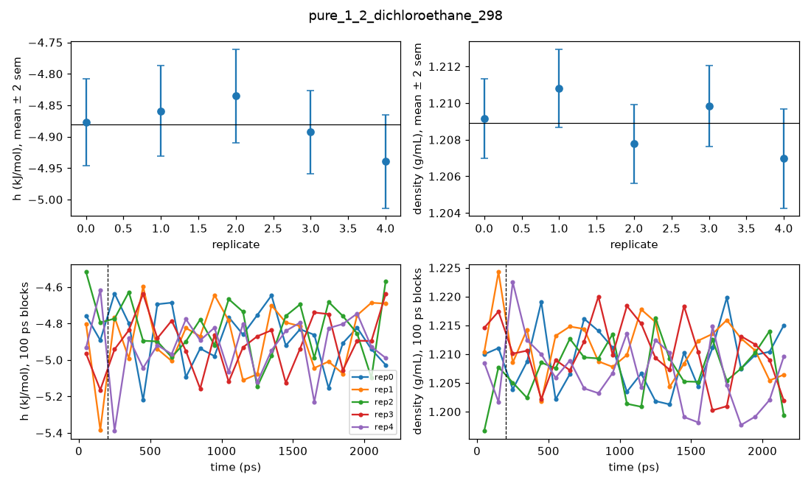
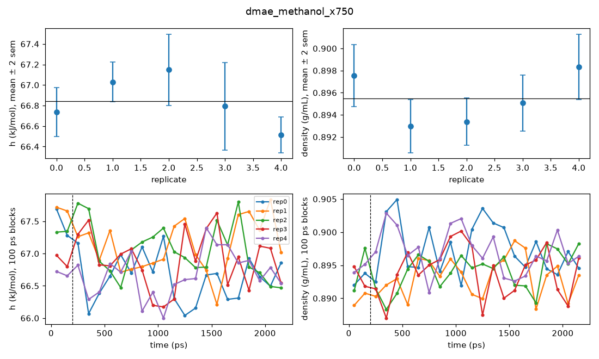
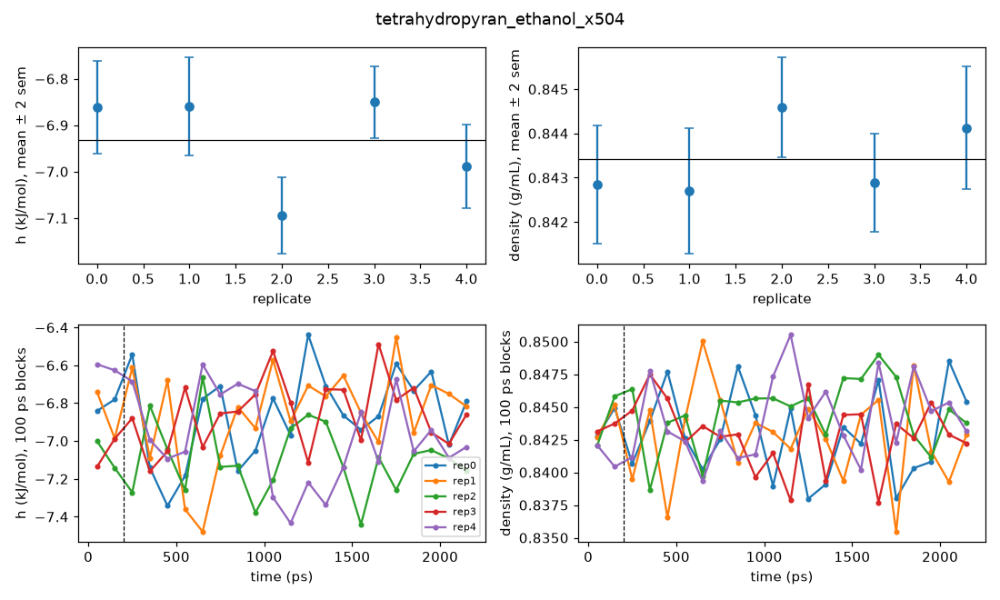
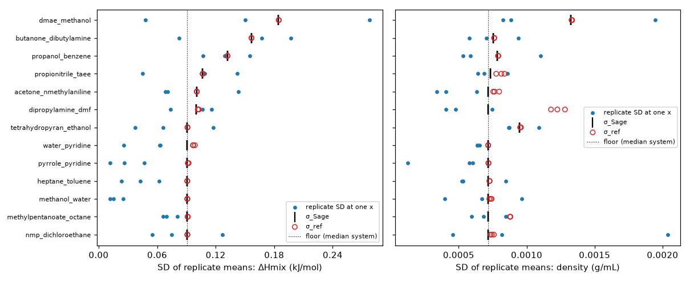
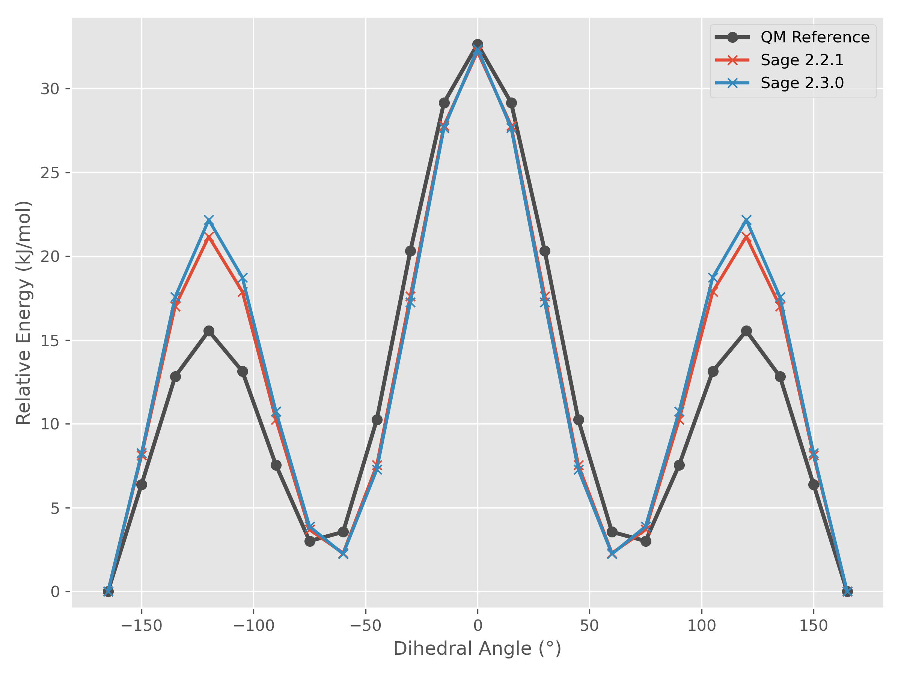

# Sage reference runs: details

Generated 2026-10-29 by `summarise_sage.py`. Summary: [report.md](report.md).

320 runs (64 boxes, 5 replicates), each 200 ps of equilibration and 2000 ps of production. 39 of 39 mixture points have all replicates. Per-run statistics: [runs.csv](runs.csv).

## Within-run vs between-run uncertainty

Within-run standard errors come from the autocorrelation (Chodera) estimator on every logged sample. If they were right, the SD of the replicate means would equal them on average (ratio 1). Each box and mixture point gets a chi-squared test of the replicate means against their within-run errors; the pooled ratio combines all of them.

| Level | Observable | Tests | Median ratio | Pooled ratio | p | p_high < 0.05 | p_low < 0.05 |
|---|---|---|---|---|---|---|---|
| box | h | 64 | 1.01 | 1.19 | 2e-05 | 10 | 5 |
| box | density | 64 | 1.10 | 1.27 | 2e-09 | 12 | 1 |
| point | hmix | 39 | 1.04 | 1.16 | 0.005 | 6 | 2 |
| point | vex | 39 | 0.85 | 1.05 | 0.4 | 5 | 3 |

**Multiple testing.** The pooled ratios are 4 tests; with a Bonferroni correction over them, box h, box density, point hmix stay significant at p < 0.05. The per-box and per-point tests are two-sided and Holm-corrected together (206 tests). The p_high counts above are unadjusted: about 3.2 per row are expected by chance. Surviving correction: pure_1_2_dichloroethane_298 (density). The evidence that within-run errors are too small therefore comes from the pooled test, not from any one box. MLP runs are single runs, so their confidence intervals will be too narrow by roughly the pooled ratio.

Largest mismatches:

## Replicate spread (MAZE denominator)

MAZE divides each error by a fixed σ_ref = sqrt(σ_Sage² + σ_exp²), the same for every model, and averages |error| / σ_ref over the points. σ_Sage is one value per mixture: the SD of the replicate means, pooled over its compositions (RMS) and floored at the median over mixtures. Pure densities use the same rule, with one box per liquid. The floor is there because model errors are mostly systematic and much larger than σ_ref, so σ_ref acts as a weight: without it, the mixtures where Sage happens to sample most quietly would dominate MAZE, although an MLP's noise there need not be as small. With the floor, MAZE stays close to the MAE divided by a single σ. nmp_dichloroethane and pure 1,2-dichloroethane are set to the floor, as their spread comes from a Sage artefact (last section).

Median σ_Sage over mixtures: 0.091 kJ/mol (ΔHmix), 0.0007 g/mL (density), 0.084 cm³/mol (V^E). The values are written to `systems.csv` and `pure.csv` (`sigma_sage_*`, `sigma_ref_*`); per-point tables are in [points.csv](points.csv) and [pure_points.csv](pure_points.csv).

## Finite-size check

Our replicate means are compared with the published runs [`fb-fit-v3-single-mean-k100`](https://github.com/openforcefield/ash-sage-rc2/blob/00c9524d38af53725a1a18feb3433f5c191cdb4a/04_benchmark/forcefields/fb-fit-v3-single-mean-k100.offxml?plain=1) (openff-2.3.0rc2, 3 replicates of 1000 molecules), whose bonded, vdW and library-charge parameters are identical to the released openff-2.3.0. Both use NAGL charges (published: model 0.1.0-rc.3, [line 487](https://github.com/openforcefield/ash-sage-rc2/blob/00c9524d38af53725a1a18feb3433f5c191cdb4a/04_benchmark/forcefields/fb-fit-v3-single-mean-k100.offxml?plain=1#L487); ours: 1.0.0), so any gap comes from box size, protocol or the NAGL version. 51 points match within |Δx| ≤ 0.02. The nearest published value is shifted to our composition along a curve fitted to the published points (two-term Redlich-Kister for ΔHmix, quadratic for density), as a composition offset alone can shift a density by more than the gaps tested. z is the gap over the combined standard error of the two means: it tests whether the gap exceeds replicate noise, not what causes it. |z| > 3: 0. All points: [finite_size.csv](finite_size.csv).

## Convergence

h is the enthalpy per molecule, (E_pot + pV) / N in kJ/mol. The block tests split production into 10 blocks of 200 ps.

- **Independent samples.** Median n_eff 530 (correlation time 3.8 ps), minimum 24. 11 runs fall below ml-peg's minimum of 100.
- **Cross-check of the standard error.** The scatter of the block means (SD / √10) over the autocorrelation sem has a median of 1.01 (h) and 0.95 (density). Single-run ratios scatter by about ±24%, so only the median is meaningful.
- **Equilibration.** The first production block (200 to 400 ps) minus the rest of the run: median |shift| 0.0014 g/mL, max 0.0084 g/mL. 10 runs exceed 0.005 g/mL. Mean shift by replicate (g/mL, with the share of boxes above 0): 0: -0.0005 (33%), 1: -0.0002 (41%), 2: -0.0004 (39%), 3: +0.0014 (80%), 4: +0.0015 (78%). A shift shared by most boxes of one replicate points at that replicate's starting structures rather than at a system.
- **Trends within a run.** Drift (slope of the block means) and half-split (first 5 blocks against the last 5) tests on h and density: 1280 tests, Holm-corrected. Flagged: 0.
- **Start dependence.** Replicate 0 (the distributed box) against a prediction interval from the rebuilt replicates; |t| > 4.0 is reported. About 3.6 of the 128 tests are expected above this by chance. All tests: [start_dependence.csv](start_dependence.csv).

Every box has a convergence plot in `figures/convergence/` and every system a plot in `figures/systems/`.

## Inspection categories

Every item is in [inspection.csv](inspection.csv), with its evidence and plots. The categories, in rough order of concern:

- **within/between mismatch** (33). Replicates (independently built boxes) scatter more than the within-run standard errors allow: likely a slow mode (conformers, local structure) that one 2 ns run does not sample, so a single run's confidence interval is too narrow there. Most entries are p < 0.05 before Holm correction only, so they are places to look, not individual results.
- **low sampling** (8). A run with fewer than 100 independent samples (long correlation times, viscous or slowly reorganising liquids).
- **start dependence** (2). The distributed box (replicate 0) differs from the rebuilt replicates, so the starting structure may bias MLP runs.
- **early density shift** (10). The density of the first production block differs from the rest of the run by more than 0.005 g/mL: still relaxing after the 0.2 ns discard, or a large fluctuation.
- **microheterogeneity** (5). Sage itself shows like-like clustering beyond random mixing; MLP demixing flags for this box should be compared against this Sage value.
- **published-Sage gap** (2). Our replicate mean differs from the published 1000-molecule run by more than 0.15 kJ/mol or 0.002 g/mL.
- **force-field miss (not a run problem)** (6). Sage is far from experiment. Expected for some systems, and useful for separating models.

## Why NMP + 1,2-dichloroethane was kept

In Sage the Cl-C-C-Cl torsion of 1,2-dichloroethane (DCE) relaxes slowly. In every DCE box (the three mixtures and pure DCE), only about 4% of DCE molecules switch between trans and gauche from one 100 ps frame to the next (49% if uncorrelated), a relaxation time of about 1.1 ns ([dce_flips.csv](dce_flips.csv)). With 20 DCE molecules in the DCE-poor box, a 2 ns run samples this poorly, so the replicates scatter more than their within-run errors. The cause is Sage's barrier. In relaxed gas-phase scans (below; energies relative to trans, [dce_torsion_scan.csv](dce_torsion_scan.csv)), the gauche/trans gap agrees with MACE-OFF23(M) (5.4 vs 5.2 kJ/mol), but the trans to gauche barrier is 25.4 vs 17.3 kJ/mol. At 298 K that makes Sage's isomerisation about 27× too slow (Arrhenius, equal prefactors). A model with a reference-like barrier should relax in about 41 ps, inside the 200 ps equilibration, and sample many flips per run, so the system is a fair test for MLPs. σ_Sage of the mixture and of pure DCE is set to the median floor so that Sage's slow sampling does not loosen the MAZE denominator.

