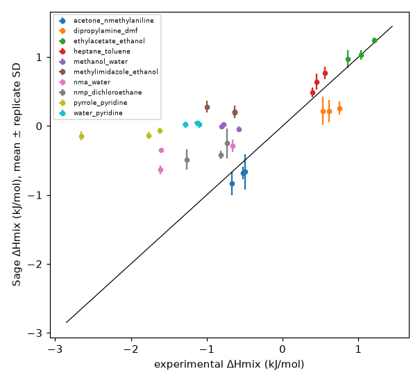
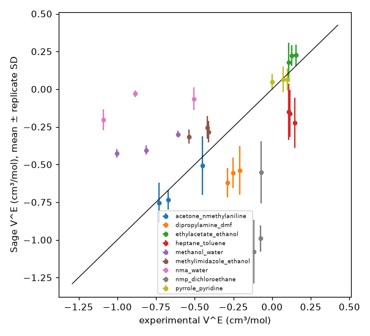
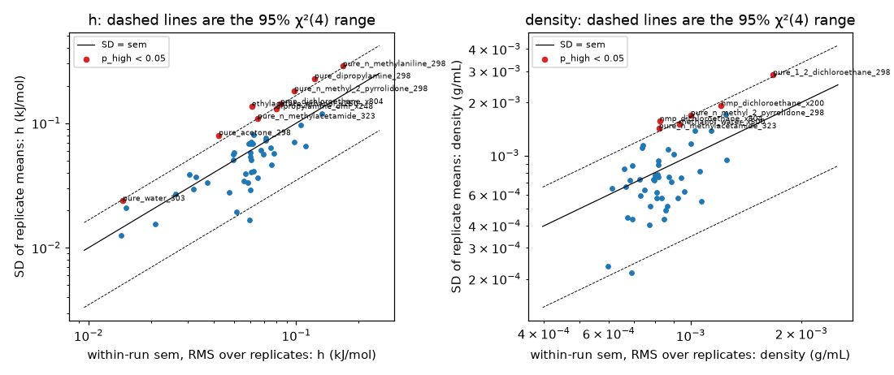
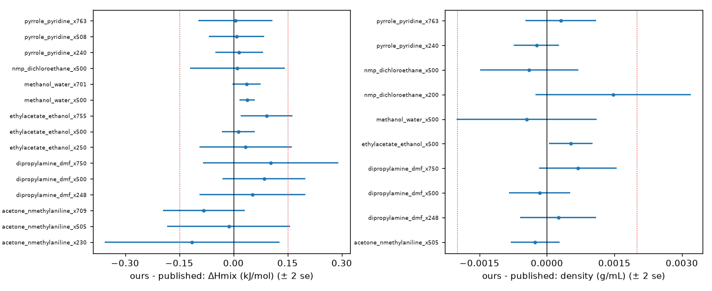

# Sage (openff-2.3.0) reference runs

Generated 2026-11-09 by `summarise_sage.py`. Methods and statistics: [details.md](details.md). Every flagged box: [inspection.csv](inspection.csv).

Sage was run through the benchmark protocol (0.2 ns NPT equilibration, 1 ns production) on all 49 boxes, 5 independent replicates each (245 runs). The replicate spread gives σ_Sage, the MAZE denominator, and Sage's own score sets the 'bad' thresholds ([power analysis](../power_analysis/report.md)).

## Sage against experiment

| Property | Points | MAE | MAZE |
|---|---|---|---|
| ΔHmix | 30 | 0.698 kJ/mol | 7.88 |
| Density | 27 | 0.0129 g/mL | 13.9 |
| V^E | 27 | 0.322 cm³/mol | 3.47 |
| Pure density | 19 | 0.0122 g/mL | 12.5 |

The largest ΔHmix errors are for pyrrole_pyridine (1.90 kJ/mol) and water_pyridine (1.20 kJ/mol, wrong sign at 3 of 3 compositions). These are force-field misses, not run problems, and they are the systems most likely to separate models.

## Run-to-run noise

Pooled over all boxes, the SD of the replicate means is 1.13× the within-run standard error for h and 1.07× for density (p = 1e-02 and 2e-01). A single 1 ns run's standard error is therefore about 13% too small for h and 7% for density, because independently built boxes sample slow modes (conformers, local structure) that one run does not. This is why σ_Sage comes from the replicate spread rather than within-run errors. Per-box tests that survive Holm correction: none.

## Boxes to inspect

46 items over 31 boxes or systems, all in [inspection.csv](inspection.csv) with links to their plots. Most are places to look rather than problems:

| Category | Items | Boxes or systems |
|---|---|---|
| within/between mismatch | 21 | 13 |
| low sampling | 7 | 7 |
| start dependence | 1 | 1 |
| early density shift | 7 | 5 |
| microheterogeneity | 3 | 3 |
| force-field miss (not a run problem) | 7 | 7 |

Those that matter for the benchmark:

- **NMP + 1,2-dichloroethane** has slow Sage torsion sampling (see below). It is kept, with σ_Sage set to the median floor.
- **Start dependence**: pure_toluene_298 (density +0.0016 g/mL, t = +4.0). The distributed box (replicate 0) differs from the rebuilt replicates by more than their spread allows, so an MLP started from it may be slightly biased.
- **Published-Sage gap**: 0 of 25 matched points (next section).

## Box size

Our boxes (≥ 100 molecules) were compared with the published 1000-molecule openff-2.3.0 runs ([`fb-fit-v3-single-mean-k100`](https://github.com/openforcefield/ash-sage-rc2/blob/00c9524d38af53725a1a18feb3433f5c191cdb4a/04_benchmark/forcefields/fb-fit-v3-single-mean-k100.offxml?plain=1)) at 25 matched points. Points with |z| > 3: 1. Points that differ by more than 0.15 kJ/mol or 0.002 g/mL: 0, none. The median ΔHmix gap is 0.037 kJ/mol and the median density gap 0.0004 g/mL, well below Sage's errors against experiment, so box size does not bias the reference overall; the points above are in [inspection.csv](inspection.csv).

## NMP + 1,2-dichloroethane

In Sage, only 4% of 1,2-dichloroethane molecules switch between trans and gauche from one 100 ps frame to the next (49% if uncorrelated), a relaxation time of about 1.1 ns. The cause is Sage's barrier, 8 kJ/mol above MACE-OFF23(M), which makes isomerisation about 27× too slow. A model with a reference-like barrier should relax in about 41 ps, well inside the equilibration, so the system is a fair test for MLPs and was kept. Details and the torsion scans: [details.md](details.md#why-nmp--12-dichloroethane-was-kept).
