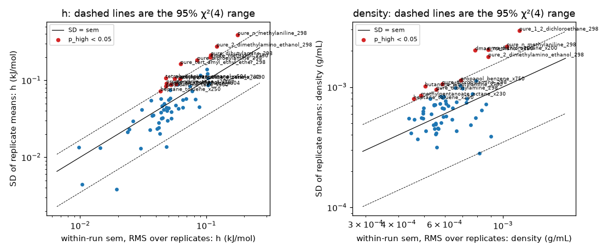
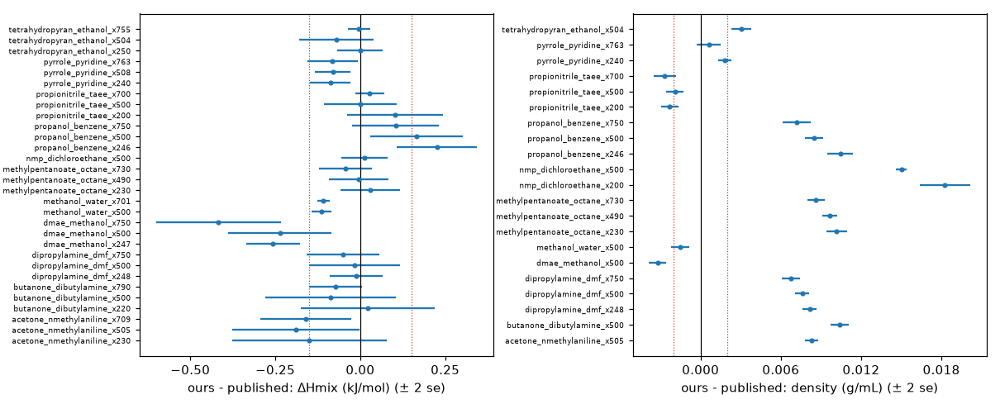
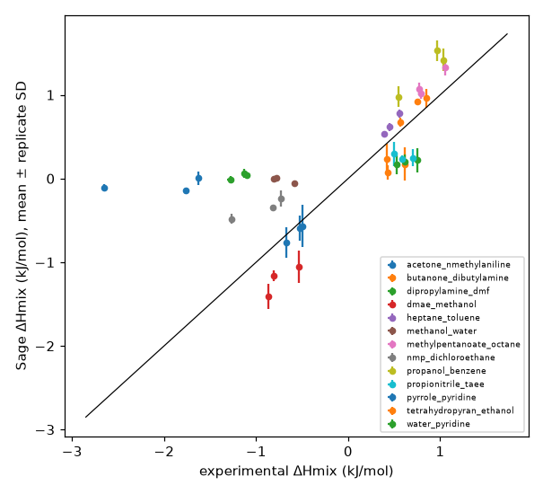
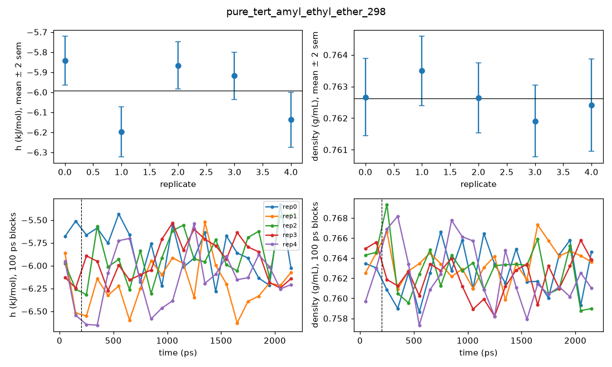
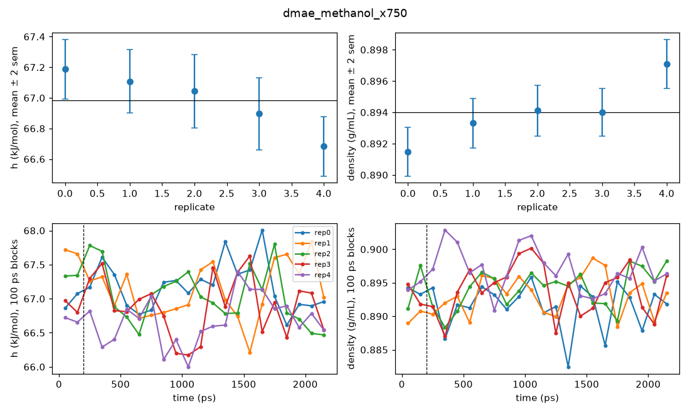
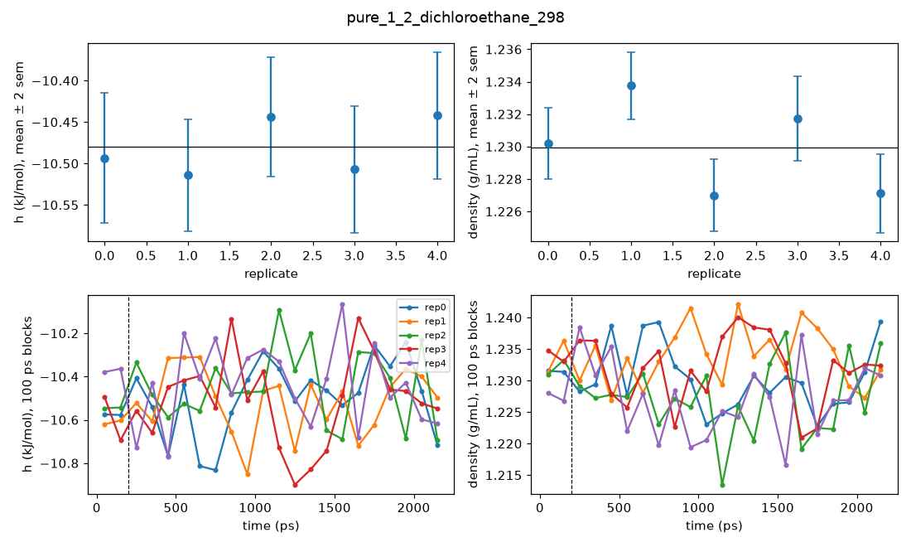
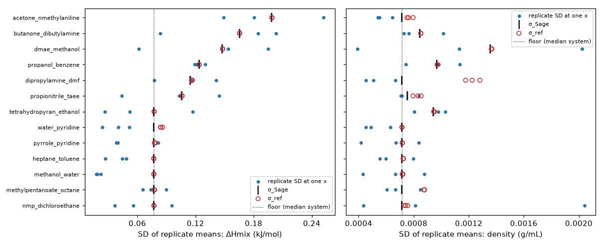

# Sage (openff-2.3.0) reference run

## Summary and systems to inspect

320 runs (64 boxes × 5 replicates) finished. Against experiment, Sage's replicate-mean ΔHmix MAE is 0.546 kJ/mol and its mixture density MAE 0.0085 g/mL.

**Within-run vs between-run uncertainty.** Within-run standard errors come from the autocorrelation (Chodera) estimator on every logged sample. Pooled over all boxes, the SD of the replicate means is 1.25× the within-run sem for h and 1.30× for density (1 expected; p = 7e-08 and 7e-11). 14 (h) and 11 (density) of 64 boxes have p_high < 0.05, against 3.2 expected by chance in each; 2 (h) and 1 (density) have p_low < 0.05. Tests still significant after Holm correction: 3. The replicates start from independently built boxes, so their spread includes slow modes a single run cannot see. MLIP runs are single runs, so their confidence intervals will be narrower than the true run-to-run spread by roughly this factor.

| Statistic | Observable | Tests | Median ratio | Pooled ratio | p | p_high < 0.05 | p_low < 0.05 |
|---|---|---|---|---|---|---|---|
| box | h | 64 | 0.93 | 1.25 | 7e-08 | 14 | 2 |
| box | density | 64 | 1.13 | 1.30 | 7e-11 | 11 | 1 |
| point | hmix | 39 | 1.04 | 1.22 | 0.0002 | 7 | 1 |
| point | vex | 39 | 0.98 | 1.08 | 0.1 | 5 | 1 |

**Multiple testing.** The pooled ratios are one test per row of the table (4 tests, uncorrected). With a Bonferroni correction over the 4, box h, box density, point hmix stay significant at p < 0.05. The per-box and per-point tests are two-sided and Holm-corrected together (206 tests, flagged at adjusted p < 0.05). The p_high < 0.05 counts above are unadjusted and should be read against the number expected by chance. Boxes listed under "within/between mismatch" below as "p < 0.05 unadjusted only" are places to look, not individually significant results; the evidence that within-run sems are too small comes from the pooled test.

**47 boxes or systems to inspect** (98 items). Categories are in rough order of concern for the benchmark.

### within/between mismatch (37)

Replicates (independently built boxes) scatter more than the within-run standard errors allow. Likely a slow mode (conformers, local structure) that one 2 ns run does not sample, so a single run's CI is too narrow here. Check the replicate time series for offsets that persist all run. Entries marked "unadjusted only" do not survive Holm correction.

| Box / system | Evidence | Plots |
|---|---|---|
| pure_tert_amyl_ethyl_ether_298 | h: replicate SD 2.6× the within-run sem (p_high = 2e-05, Holm-significant) | [replicates](figures/replicates/pure_tert_amyl_ethyl_ether_298.png), [convergence](figures/convergence/pure_tert_amyl_ethyl_ether_298.png) |
| dmae_methanol_x750 | density: replicate SD 2.6× the within-run sem (p_high = 2e-05, Holm-significant) | [replicates](figures/replicates/dmae_methanol_x750.png), [convergence](figures/convergence/dmae_methanol_x750.png) |
| pure_1_2_dichloroethane_298 | density: replicate SD 2.5× the within-run sem (p_high = 3e-05, Holm-significant) | [replicates](figures/replicates/pure_1_2_dichloroethane_298.png), [convergence](figures/convergence/pure_1_2_dichloroethane_298.png) |
| nmp_dichloroethane_x200 | density: replicate SD 2.3× the within-run sem (p_high = 0.0002, p < 0.05 unadjusted only) | [replicates](figures/replicates/nmp_dichloroethane_x200.png), [convergence](figures/convergence/nmp_dichloroethane_x200.png) |
| pure_2_dimethylamino_ethanol_298 | h: replicate SD 2.3× the within-run sem (p_high = 0.0003, p < 0.05 unadjusted only) | [replicates](figures/replicates/pure_2_dimethylamino_ethanol_298.png), [convergence](figures/convergence/pure_2_dimethylamino_ethanol_298.png) |
| tetrahydropyran_ethanol_x504 | h: replicate SD 2.2× the within-run sem (p_high = 0.0004, p < 0.05 unadjusted only) | [replicates](figures/replicates/tetrahydropyran_ethanol_x504.png), [convergence](figures/convergence/tetrahydropyran_ethanol_x504.png) |
| pure_n_methylaniline_298 | h: replicate SD 2.2× the within-run sem (p_high = 0.0006, p < 0.05 unadjusted only) | [replicates](figures/replicates/pure_n_methylaniline_298.png), [convergence](figures/convergence/pure_n_methylaniline_298.png) |
| pure_dipropylamine_298 | h: replicate SD 2.2× the within-run sem (p_high = 0.0008, p < 0.05 unadjusted only) | [replicates](figures/replicates/pure_dipropylamine_298.png), [convergence](figures/convergence/pure_dipropylamine_298.png) |
| pure_n_methylaniline_298 | density: replicate SD 2.1× the within-run sem (p_high = 0.001, p < 0.05 unadjusted only) | [replicates](figures/replicates/pure_n_methylaniline_298.png), [convergence](figures/convergence/pure_n_methylaniline_298.png) |
| acetone_nmethylaniline_x709 | hmix: replicate SD 2.1× the within-run sem (p_high = 0.002, p < 0.05 unadjusted only) | [replicates](figures/replicates/acetone_nmethylaniline_x709.png), [convergence](figures/convergence/acetone_nmethylaniline_x709.png) |
| dmae_methanol_x750 | vex: replicate SD 2.1× the within-run sem (p_high = 0.002, p < 0.05 unadjusted only) | [replicates](figures/replicates/dmae_methanol_x750.png), [convergence](figures/convergence/dmae_methanol_x750.png) |
| pure_2_dimethylamino_ethanol_298 | density: replicate SD 2.0× the within-run sem (p_high = 0.002, p < 0.05 unadjusted only) | [replicates](figures/replicates/pure_2_dimethylamino_ethanol_298.png), [convergence](figures/convergence/pure_2_dimethylamino_ethanol_298.png) |
| butanone_dibutylamine_x790 | density: replicate SD 2.0× the within-run sem (p_high = 0.003, p < 0.05 unadjusted only) | [replicates](figures/replicates/butanone_dibutylamine_x790.png), [convergence](figures/convergence/butanone_dibutylamine_x790.png) |
| tetrahydropyran_ethanol_x504 | hmix: replicate SD 2.0× the within-run sem (p_high = 0.003, p < 0.05 unadjusted only) | [replicates](figures/replicates/tetrahydropyran_ethanol_x504.png), [convergence](figures/convergence/tetrahydropyran_ethanol_x504.png) |
| propionitrile_taee_x200 | hmix: replicate SD 2.0× the within-run sem (p_high = 0.003, p < 0.05 unadjusted only) | [replicates](figures/replicates/propionitrile_taee_x200.png), [convergence](figures/convergence/propionitrile_taee_x200.png) |
| butanone_dibutylamine_x220 | vex: replicate SD 2.0× the within-run sem (p_high = 0.004, p < 0.05 unadjusted only) | [replicates](figures/replicates/butanone_dibutylamine_x220.png), [convergence](figures/convergence/butanone_dibutylamine_x220.png) |
| pure_dibutylamine_298 | h: replicate SD 2.0× the within-run sem (p_high = 0.004, p < 0.05 unadjusted only) | [replicates](figures/replicates/pure_dibutylamine_298.png), [convergence](figures/convergence/pure_dibutylamine_298.png) |
| propionitrile_taee_x700 | h: replicate SD 1.9× the within-run sem (p_high = 0.006, p < 0.05 unadjusted only) | [replicates](figures/replicates/propionitrile_taee_x700.png), [convergence](figures/convergence/propionitrile_taee_x700.png) |
| methylpentanoate_octane_x730 | h: replicate SD 1.9× the within-run sem (p_high = 0.008, p < 0.05 unadjusted only) | [replicates](figures/replicates/methylpentanoate_octane_x730.png), [convergence](figures/convergence/methylpentanoate_octane_x730.png) |
| dmae_methanol_x750 | h: replicate SD 1.9× the within-run sem (p_high = 0.008, p < 0.05 unadjusted only) | [replicates](figures/replicates/dmae_methanol_x750.png), [convergence](figures/convergence/dmae_methanol_x750.png) |
| pure_dipropylamine_298 | density: replicate SD 1.8× the within-run sem (p_high = 0.01, p < 0.05 unadjusted only) | [replicates](figures/replicates/pure_dipropylamine_298.png), [convergence](figures/convergence/pure_dipropylamine_298.png) |
| propionitrile_taee_x500 | hmix: replicate SD 1.8× the within-run sem (p_high = 0.02, p < 0.05 unadjusted only) | [replicates](figures/replicates/propionitrile_taee_x500.png), [convergence](figures/convergence/propionitrile_taee_x500.png) |
| propionitrile_taee_x500 | h: replicate SD 1.8× the within-run sem (p_high = 0.02, p < 0.05 unadjusted only) | [replicates](figures/replicates/propionitrile_taee_x500.png), [convergence](figures/convergence/propionitrile_taee_x500.png) |
| heptane_toluene_x250 | density: replicate SD 1.7× the within-run sem (p_high = 0.02, p < 0.05 unadjusted only) | [replicates](figures/replicates/heptane_toluene_x250.png), [convergence](figures/convergence/heptane_toluene_x250.png) |
| methylpentanoate_octane_x230 | density: replicate SD 1.7× the within-run sem (p_high = 0.02, p < 0.05 unadjusted only) | [replicates](figures/replicates/methylpentanoate_octane_x230.png), [convergence](figures/convergence/methylpentanoate_octane_x230.png) |
| butanone_dibutylamine_x500 | hmix: replicate SD 1.7× the within-run sem (p_high = 0.02, p < 0.05 unadjusted only) | [replicates](figures/replicates/butanone_dibutylamine_x500.png), [convergence](figures/convergence/butanone_dibutylamine_x500.png) |
| pure_dibutylamine_298 | density: replicate SD 1.7× the within-run sem (p_high = 0.02, p < 0.05 unadjusted only) | [replicates](figures/replicates/pure_dibutylamine_298.png), [convergence](figures/convergence/pure_dibutylamine_298.png) |
| dipropylamine_dmf_x500 | hmix: replicate SD 1.7× the within-run sem (p_high = 0.02, p < 0.05 unadjusted only) | [replicates](figures/replicates/dipropylamine_dmf_x500.png), [convergence](figures/convergence/dipropylamine_dmf_x500.png) |
| methylpentanoate_octane_x490 | h: replicate SD 1.7× the within-run sem (p_high = 0.02, p < 0.05 unadjusted only) | [replicates](figures/replicates/methylpentanoate_octane_x490.png), [convergence](figures/convergence/methylpentanoate_octane_x490.png) |
| nmp_dichloroethane_x804 | h: replicate SD 1.7× the within-run sem (p_high = 0.02, p < 0.05 unadjusted only) | [replicates](figures/replicates/nmp_dichloroethane_x804.png), [convergence](figures/convergence/nmp_dichloroethane_x804.png) |
| heptane_toluene_x250 | h: replicate SD 1.7× the within-run sem (p_high = 0.02, p < 0.05 unadjusted only) | [replicates](figures/replicates/heptane_toluene_x250.png), [convergence](figures/convergence/heptane_toluene_x250.png) |
| propanol_benzene_x750 | density: replicate SD 1.6× the within-run sem (p_high = 0.03, p < 0.05 unadjusted only) | [replicates](figures/replicates/propanol_benzene_x750.png), [convergence](figures/convergence/propanol_benzene_x750.png) |
| acetone_nmethylaniline_x505 | hmix: replicate SD 1.6× the within-run sem (p_high = 0.03, p < 0.05 unadjusted only) | [replicates](figures/replicates/acetone_nmethylaniline_x505.png), [convergence](figures/convergence/acetone_nmethylaniline_x505.png) |
| butanone_dibutylamine_x500 | vex: replicate SD 1.6× the within-run sem (p_high = 0.03, p < 0.05 unadjusted only) | [replicates](figures/replicates/butanone_dibutylamine_x500.png), [convergence](figures/convergence/butanone_dibutylamine_x500.png) |
| acetone_nmethylaniline_x709 | vex: replicate SD 1.6× the within-run sem (p_high = 0.04, p < 0.05 unadjusted only) | [replicates](figures/replicates/acetone_nmethylaniline_x709.png), [convergence](figures/convergence/acetone_nmethylaniline_x709.png) |
| nmp_dichloroethane_x500 | vex: replicate SD 1.6× the within-run sem (p_high = 0.05, p < 0.05 unadjusted only) | [replicates](figures/replicates/nmp_dichloroethane_x500.png), [convergence](figures/convergence/nmp_dichloroethane_x500.png) |
| dmae_methanol_x247 | h: replicate SD 1.6× the within-run sem (p_high = 0.05, p < 0.05 unadjusted only) | [replicates](figures/replicates/dmae_methanol_x247.png), [convergence](figures/convergence/dmae_methanol_x247.png) |

### low sampling (9)

Long correlation times (viscous or slowly reorganising liquids). Check that block means still wander in the convergence plot.

| Box / system | Evidence | Plots |
|---|---|---|
| acetone_nmethylaniline_x230 | 1 replicate(s) with n_eff < 100 (minimum 83, τ up to 24 ps) | [replicates](figures/replicates/acetone_nmethylaniline_x230.png), [convergence](figures/convergence/acetone_nmethylaniline_x230.png) |
| butanone_dibutylamine_x500 | 1 replicate(s) with n_eff < 100 (minimum 91, τ up to 22 ps) | [replicates](figures/replicates/butanone_dibutylamine_x500.png), [convergence](figures/convergence/butanone_dibutylamine_x500.png) |
| dmae_methanol_x500 | 1 replicate(s) with n_eff < 100 (minimum 84, τ up to 24 ps) | [replicates](figures/replicates/dmae_methanol_x500.png), [convergence](figures/convergence/dmae_methanol_x500.png) |
| propanol_benzene_x246 | 1 replicate(s) with n_eff < 100 (minimum 52, τ up to 39 ps) | [replicates](figures/replicates/propanol_benzene_x246.png), [convergence](figures/convergence/propanol_benzene_x246.png) |
| propanol_benzene_x500 | 1 replicate(s) with n_eff < 100 (minimum 47, τ up to 42 ps) | [replicates](figures/replicates/propanol_benzene_x500.png), [convergence](figures/convergence/propanol_benzene_x500.png) |
| propanol_benzene_x750 | 2 replicate(s) with n_eff < 100 (minimum 95, τ up to 21 ps) | [replicates](figures/replicates/propanol_benzene_x750.png), [convergence](figures/convergence/propanol_benzene_x750.png) |
| pure_1_propanol_298 | 1 replicate(s) with n_eff < 100 (minimum 95, τ up to 21 ps) | [replicates](figures/replicates/pure_1_propanol_298.png), [convergence](figures/convergence/pure_1_propanol_298.png) |
| pure_2_dimethylamino_ethanol_298 | 1 replicate(s) with n_eff < 100 (minimum 69, τ up to 29 ps) | [replicates](figures/replicates/pure_2_dimethylamino_ethanol_298.png), [convergence](figures/convergence/pure_2_dimethylamino_ethanol_298.png) |
| pure_n_methylaniline_298 | 3 replicate(s) with n_eff < 100 (minimum 24, τ up to 85 ps) | [replicates](figures/replicates/pure_n_methylaniline_298.png), [convergence](figures/convergence/pure_n_methylaniline_298.png) |

### start dependence (6)

The distributed box (replicate 0) differs from the rebuilt replicates; the starting structure may bias MLIP runs.

| Box / system | Evidence | Plots |
|---|---|---|
| acetone_nmethylaniline_x230 | density_mean: replicate 0 offset +0.0013 (t = +4.3) | [replicates](figures/replicates/acetone_nmethylaniline_x230.png), [convergence](figures/convergence/acetone_nmethylaniline_x230.png) |
| acetone_nmethylaniline_x709 | h_mean: replicate 0 offset +0.0660 (t = +4.1) | [replicates](figures/replicates/acetone_nmethylaniline_x709.png), [convergence](figures/convergence/acetone_nmethylaniline_x709.png) |
| pure_n_methylaniline_298 | h_mean: replicate 0 offset -0.8043 (t = -4.1) | [replicates](figures/replicates/pure_n_methylaniline_298.png), [convergence](figures/convergence/pure_n_methylaniline_298.png) |
| pure_n_methylaniline_298 | density_mean: replicate 0 offset +0.0047 (t = +7.2) | [replicates](figures/replicates/pure_n_methylaniline_298.png), [convergence](figures/convergence/pure_n_methylaniline_298.png) |
| pyrrole_pyridine_x240 | density_mean: replicate 0 offset -0.0009 (t = -5.5) | [replicates](figures/replicates/pyrrole_pyridine_x240.png), [convergence](figures/convergence/pyrrole_pyridine_x240.png) |
| pyrrole_pyridine_x763 | h_mean: replicate 0 offset +0.1179 (t = +4.1) | [replicates](figures/replicates/pyrrole_pyridine_x763.png), [convergence](figures/convergence/pyrrole_pyridine_x763.png) |

### early density shift (10)

Density still relaxing after the 0.2 ns discard, or a large fluctuation. Compare the replicates' time series.

| Box / system | Evidence | Plots |
|---|---|---|
| methanol_water_x701 | rep4: 200–400 ps density differs from the rest by +0.0075 g/mL | [replicates](figures/replicates/methanol_water_x701.png), [convergence](figures/convergence/methanol_water_x701.png) |
| dmae_methanol_x750 | rep3: 200–400 ps density differs from the rest by -0.0053 g/mL | [replicates](figures/replicates/dmae_methanol_x750.png), [convergence](figures/convergence/dmae_methanol_x750.png) |
| acetone_nmethylaniline_x230 | rep0: 200–400 ps density differs from the rest by +0.0075 g/mL | [replicates](figures/replicates/acetone_nmethylaniline_x230.png), [convergence](figures/convergence/acetone_nmethylaniline_x230.png) |
| propanol_benzene_x750 | rep3: 200–400 ps density differs from the rest by +0.0055 g/mL | [replicates](figures/replicates/propanol_benzene_x750.png), [convergence](figures/convergence/propanol_benzene_x750.png) |
| tetrahydropyran_ethanol_x504 | rep0: 200–400 ps density differs from the rest by -0.0065 g/mL | [replicates](figures/replicates/tetrahydropyran_ethanol_x504.png), [convergence](figures/convergence/tetrahydropyran_ethanol_x504.png) |
| pure_water_298 | rep4: 200–400 ps density differs from the rest by +0.0055 g/mL | [replicates](figures/replicates/pure_water_298.png), [convergence](figures/convergence/pure_water_298.png) |
| pure_1_2_dichloroethane_298 | rep3: 200–400 ps density differs from the rest by +0.0051 g/mL | [replicates](figures/replicates/pure_1_2_dichloroethane_298.png), [convergence](figures/convergence/pure_1_2_dichloroethane_298.png) |
| pure_1_2_dichloroethane_298 | rep4: 200–400 ps density differs from the rest by +0.0084 g/mL | [replicates](figures/replicates/pure_1_2_dichloroethane_298.png), [convergence](figures/convergence/pure_1_2_dichloroethane_298.png) |
| pure_n_methylaniline_298 | rep1: 200–400 ps density differs from the rest by +0.0055 g/mL | [replicates](figures/replicates/pure_n_methylaniline_298.png), [convergence](figures/convergence/pure_n_methylaniline_298.png) |
| pure_tert_amyl_ethyl_ether_298 | rep4: 200–400 ps density differs from the rest by +0.0057 g/mL | [replicates](figures/replicates/pure_tert_amyl_ethyl_ether_298.png), [convergence](figures/convergence/pure_tert_amyl_ethyl_ether_298.png) |

Mean first-block shift over all boxes, by replicate. A shift common to most boxes of one replicate points at that replicate's starting structures rather than at a system:

| Replicate | Mean shift (g/mL) | Boxes with shift > 0 |
|---|---|---|
| 0 | -0.0004 | 42% |
| 1 | -0.0003 | 39% |
| 2 | -0.0004 | 39% |
| 3 | +0.0014 | 80% |
| 4 | +0.0015 | 78% |

### microheterogeneity (5)

Sage itself shows like-like clustering beyond random mixing; MLIP demixing flags for this box compare against this Sage value.

| Box / system | Evidence | Plots |
|---|---|---|
| propanol_benzene_x500 | like-neighbour fraction 0.563 vs 0.496 for random mixing | [replicates](figures/replicates/propanol_benzene_x500.png), [convergence](figures/convergence/propanol_benzene_x500.png) |
| tetrahydropyran_ethanol_x504 | like-neighbour fraction 0.548 vs 0.496 for random mixing | [replicates](figures/replicates/tetrahydropyran_ethanol_x504.png), [convergence](figures/convergence/tetrahydropyran_ethanol_x504.png) |
| water_pyridine_x296 | like-neighbour fraction 0.654 vs 0.580 for random mixing | [replicates](figures/replicates/water_pyridine_x296.png), [convergence](figures/convergence/water_pyridine_x296.png) |
| water_pyridine_x495 | like-neighbour fraction 0.600 vs 0.497 for random mixing | [replicates](figures/replicates/water_pyridine_x495.png), [convergence](figures/convergence/water_pyridine_x495.png) |
| water_pyridine_x700 | like-neighbour fraction 0.694 vs 0.579 for random mixing | [replicates](figures/replicates/water_pyridine_x700.png), [convergence](figures/convergence/water_pyridine_x700.png) |

### published-Sage gap (24)

Our replicate mean minus the published openff-2.3.0rc1 mean (3 replicates, 1000 molecules) at our composition, beyond 0.15 kJ/mol or 0.002 g/mL. The published runs use the 2.3.0rc1 parameters ([offxml](https://github.com/openforcefield/ash-sage-rc2/blob/00c9524d38af53725a1a18feb3433f5c191cdb4a/04_benchmark/forcefields/openff-2.3.0rc1.offxml?plain=1), which has no charge handler beyond library charges, so its charge model is not stated), and the 2.3.0 release changes many bonded and some vdW parameters from rc1. The gap therefore mixes box size and protocol with force-field differences and is not a clean finite-size test. z is the gap over the combined standard error of the two means: it tests whether the gap exceeds replicate noise, not what causes it. The plot shows every matched point (± 2 se), with the thresholds dotted.

| Box / system | Evidence | Plots |
|---|---|---|
| acetone_nmethylaniline_x505 | hmix: ours − published -0.1891 (z = -2.0) | [system](figures/systems/acetone_nmethylaniline.png) |
| acetone_nmethylaniline_x505 | density: ours − published +0.0083 (z = +33.2) | [system](figures/systems/acetone_nmethylaniline.png) |
| acetone_nmethylaniline_x709 | hmix: ours − published -0.1608 (z = -2.4) | [system](figures/systems/acetone_nmethylaniline.png) |
| butanone_dibutylamine_x500 | density: ours − published +0.0104 (z = +31.3) | [system](figures/systems/butanone_dibutylamine.png) |
| dipropylamine_dmf_x248 | density: ours − published +0.0082 (z = +31.9) | [system](figures/systems/dipropylamine_dmf.png) |
| dipropylamine_dmf_x500 | density: ours − published +0.0076 (z = +29.5) | [system](figures/systems/dipropylamine_dmf.png) |
| dipropylamine_dmf_x750 | density: ours − published +0.0068 (z = +20.5) | [system](figures/systems/dipropylamine_dmf.png) |
| dmae_methanol_x247 | hmix: ours − published -0.2564 (z = -6.4) | [system](figures/systems/dmae_methanol.png) |
| dmae_methanol_x500 | hmix: ours − published -0.2362 (z = -3.1) | [system](figures/systems/dmae_methanol.png) |
| dmae_methanol_x500 | density: ours − published -0.0032 (z = -10.1) | [system](figures/systems/dmae_methanol.png) |
| dmae_methanol_x750 | hmix: ours − published -0.4172 (z = -4.5) | [system](figures/systems/dmae_methanol.png) |
| methylpentanoate_octane_x230 | density: ours − published +0.0102 (z = +26.7) | [system](figures/systems/methylpentanoate_octane.png) |
| methylpentanoate_octane_x490 | density: ours − published +0.0096 (z = +34.1) | [system](figures/systems/methylpentanoate_octane.png) |
| methylpentanoate_octane_x730 | density: ours − published +0.0086 (z = +27.6) | [system](figures/systems/methylpentanoate_octane.png) |
| nmp_dichloroethane_x200 | density: ours − published +0.0183 (z = +19.2) | [system](figures/systems/nmp_dichloroethane.png) |
| nmp_dichloroethane_x500 | density: ours − published +0.0150 (z = +72.8) | [system](figures/systems/nmp_dichloroethane.png) |
| propanol_benzene_x246 | hmix: ours − published +0.2262 (z = +3.8) | [system](figures/systems/propanol_benzene.png) |
| propanol_benzene_x246 | density: ours − published +0.0104 (z = +22.0) | [system](figures/systems/propanol_benzene.png) |
| propanol_benzene_x500 | hmix: ours − published +0.1660 (z = +2.4) | [system](figures/systems/propanol_benzene.png) |
| propanol_benzene_x500 | density: ours − published +0.0085 (z = +25.0) | [system](figures/systems/propanol_benzene.png) |
| propanol_benzene_x750 | density: ours − published +0.0072 (z = +13.9) | [system](figures/systems/propanol_benzene.png) |
| propionitrile_taee_x200 | density: ours − published -0.0023 (z = -7.1) | [system](figures/systems/propionitrile_taee.png) |
| propionitrile_taee_x700 | density: ours − published -0.0027 (z = -6.4) | [system](figures/systems/propionitrile_taee.png) |
| tetrahydropyran_ethanol_x504 | density: ours − published +0.0030 (z = +8.1) | [system](figures/systems/tetrahydropyran_ethanol.png) |

### force-field miss (not a run problem) (7)

Sage is far from experiment; expected for some systems and useful for discriminating models.

| Box / system | Evidence | Plots |
|---|---|---|
| dipropylamine_dmf | mean |ΔHmix error| 0.43 kJ/mol | [system](figures/systems/dipropylamine_dmf.png) |
| dmae_methanol | mean |ΔHmix error| 0.47 kJ/mol | [system](figures/systems/dmae_methanol.png) |
| methanol_water | mean |ΔHmix error| 0.70 kJ/mol, wrong sign at 1 of 3 x | [system](figures/systems/methanol_water.png) |
| nmp_dichloroethane | mean |ΔHmix error| 0.58 kJ/mol | [system](figures/systems/nmp_dichloroethane.png) |
| propanol_benzene | mean |ΔHmix error| 0.45 kJ/mol | [system](figures/systems/propanol_benzene.png) |
| pyrrole_pyridine | mean |ΔHmix error| 1.93 kJ/mol, wrong sign at 1 of 3 x | [system](figures/systems/pyrrole_pyridine.png) |
| water_pyridine | mean |ΔHmix error| 1.20 kJ/mol, wrong sign at 2 of 3 x | [system](figures/systems/water_pyridine.png) |

Largest within/between mismatches:

## Details

- Runs finished: 320 (64 boxes, up to 5 replicates).
- Mixture points with all replicates: 39 of 39.
- Production per run: 2000 ps after 200 ps equilibration.

## Replicate spread (MAZE denominator)

MAZE (mean absolute z-score error) is the ml-peg metric for ΔHmix and mixture density: |model − experiment| / σ_ref averaged over all 39 ΔHmix points (36 density points), giving one number per model. The denominator is σ_ref = sqrt(σ_Sage² + σ_exp²) (the σ_ref columns below, written to `systems.csv` as `sigma_ref_hmix` and `sigma_ref_density`), fixed per point and the same for every model. σ_Sage is one value per mixture: the SD of the replicate means, pooled over its compositions (RMS) and floored at the median over mixtures. σ_ref differs between a mixture's compositions only through σ_exp. The floor is there because model errors are mostly systematic and much larger than σ_ref, so σ_ref acts as a per-mixture weight: without the floor, the mixtures where Sage happens to sample most quietly would dominate MAZE, although an MLIP's noise there need not be as small. With the floor, mixtures are weighted roughly evenly and MAZE stays close to the MAE divided by a single σ. Exception: σ_Sage of nmp_dichloroethane is set to the floor, as its Sage spread comes from a force-field artefact (see the last section).

| System | x | ΔHmix Sage | ΔHmix exp | SD | σ_Sage | σ_ref | ρ Sage | ρ exp | ρ SD | σ_ref ρ |
|---|---|---|---|---|---|---|---|---|---|---|
| acetone_nmethylaniline | 0.230 | -0.568 | -0.498 | 0.252 | 0.199 | 0.199 | 0.9667 | 0.9532 | 0.0006 | 0.0008 |
| acetone_nmethylaniline | 0.505 | -0.767 | -0.673 | 0.181 | 0.199 | 0.199 | 0.9193 | 0.9089 | 0.0005 | 0.0008 |
| acetone_nmethylaniline | 0.709 | -0.596 | -0.526 | 0.149 | 0.199 | 0.199 | 0.8747 | 0.8664 | 0.0006 | 0.0008 |
| butanone_dibutylamine | 0.220 | 0.230 | 0.423 | 0.184 | 0.166 | 0.166 | 0.7689 | 0.7604 | 0.0008 | 0.0009 |
| butanone_dibutylamine | 0.500 | 0.175 | 0.619 | 0.203 | 0.166 | 0.166 | 0.7758 | 0.7693 | 0.0007 | 0.0009 |
| butanone_dibutylamine | 0.790 | 0.075 | 0.428 | 0.084 | 0.166 | 0.166 | 0.7850 | 0.7837 | 0.0010 | 0.0009 |
| dipropylamine_dmf | 0.248 | 0.206 | 0.612 | 0.077 | 0.115 | 0.116 | 0.8640 | 0.8687 | 0.0005 | 0.0013 |
| dipropylamine_dmf | 0.500 | 0.218 | 0.748 | 0.142 | 0.115 | 0.117 | 0.8146 | 0.8115 | 0.0005 | 0.0012 |
| dipropylamine_dmf | 0.750 | 0.164 | 0.528 | 0.116 | 0.115 | 0.116 | 0.7749 | 0.7681 | 0.0007 | 0.0012 |
| dmae_methanol | 0.247 | -1.163 | -0.804 | 0.062 | 0.148 | 0.148 | 0.8391 | 0.8437 | 0.0011 | 0.0014 |
| dmae_methanol | 0.500 | -1.409 | -0.865 | 0.154 | 0.148 | 0.148 | 0.8747 | 0.8684 | 0.0004 | 0.0014 |
| dmae_methanol | 0.750 | -1.054 | -0.533 | 0.195 | 0.148 | 0.148 | 0.8940 | 0.8777 | 0.0020 | 0.0014 |
| heptane_toluene | 0.250 | 0.618 | 0.451 | 0.049 | 0.077 | 0.077 | 0.8132 | 0.8039 | 0.0008 | 0.0007 |
| heptane_toluene | 0.500 | 0.777 | 0.556 | 0.045 | 0.077 | 0.077 | 0.7619 | 0.7554 | 0.0006 | 0.0007 |
| heptane_toluene | 0.750 | 0.536 | 0.391 | 0.027 | 0.077 | 0.077 | 0.7182 | 0.7145 | 0.0006 | 0.0007 |
| methanol_water | 0.199 | -0.007 | -0.805 | 0.018 | 0.077 | 0.077 | 0.9175 | 0.9473 | 0.0004 | 0.0007 |
| methanol_water | 0.500 | 0.007 | -0.777 | 0.023 | 0.077 | 0.077 | 0.8448 | 0.8813 | 0.0007 | 0.0007 |
| methanol_water | 0.701 | -0.061 | -0.581 | 0.019 | 0.077 | 0.077 | 0.8097 | 0.8401 | 0.0009 | 0.0007 |
| methylpentanoate_octane | 0.230 | 1.073 | 0.769 | 0.074 | 0.077 | 0.077 | 0.7354 | 0.7323 | 0.0008 | 0.0009 |
| methylpentanoate_octane | 0.490 | 1.326 | 1.053 | 0.090 | 0.077 | 0.078 | 0.7807 | 0.7764 | 0.0006 | 0.0009 |
| methylpentanoate_octane | 0.730 | 1.016 | 0.789 | 0.066 | 0.077 | 0.077 | 0.8283 | 0.8234 | 0.0007 | 0.0009 |
| nmp_dichloroethane | 0.200 | -0.349 | -0.817 | 0.037 | 0.077 | 0.077 | 1.1923 | 1.1960 | 0.0020 | 0.0008 |
| nmp_dichloroethane | 0.500 | -0.480 | -1.264 | 0.056 | 0.077 | 0.077 | 1.1250 | 1.1278 | 0.0004 | 0.0007 |
| nmp_dichloroethane | 0.804 | -0.235 | -0.735 | 0.095 | 0.077 | 0.077 | 1.0565 | 1.0652 | 0.0008 | 0.0007 |
| propanol_benzene | 0.245 | 1.419 | 1.039 | 0.130 | 0.124 | 0.124 | 0.8701 | 0.8563 | 0.0010 | 0.0010 |
| propanol_benzene | 0.500 | 1.527 | 0.968 | 0.119 | 0.124 | 0.124 | 0.8489 | 0.8389 | 0.0007 | 0.0010 |
| propanol_benzene | 0.750 | 0.976 | 0.551 | 0.122 | 0.124 | 0.124 | 0.8274 | 0.8205 | 0.0011 | 0.0010 |
| propionitrile_taee | 0.200 | 0.294 | 0.501 | 0.145 | 0.106 | 0.106 | 0.7636 | 0.7638 | 0.0007 | 0.0008 |
| propionitrile_taee | 0.500 | 0.247 | 0.703 | 0.103 | 0.106 | 0.106 | 0.7661 | 0.7683 | 0.0007 | 0.0008 |
| propionitrile_taee | 0.700 | 0.236 | 0.588 | 0.044 | 0.106 | 0.106 | 0.7662 | 0.7715 | 0.0008 | 0.0009 |
| pyrrole_pyridine | 0.240 | -0.143 | -1.767 | 0.038 | 0.077 | 0.078 | 0.9821 | 0.9754 | 0.0004 | 0.0007 |
| pyrrole_pyridine | 0.508 | -0.106 | -2.650 | 0.040 | 0.077 | 0.079 | 0.9811 | 0.9712 | 0.0007 | 0.0007 |
| pyrrole_pyridine | 0.763 | 0.005 | -1.625 | 0.082 | 0.077 | 0.078 | 0.9808 | 0.9675 | 0.0008 | 0.0007 |
| tetrahydropyran_ethanol | 0.250 | 0.673 | 0.570 | 0.052 | 0.077 | 0.077 | 0.8210 | 0.8189 | 0.0010 | 0.0010 |
| tetrahydropyran_ethanol | 0.504 | 0.959 | 0.851 | 0.117 | 0.077 | 0.077 | 0.8436 | 0.8441 | 0.0008 | 0.0009 |
| tetrahydropyran_ethanol | 0.755 | 0.923 | 0.747 | 0.026 | 0.077 | 0.077 | 0.8610 | 0.8633 | 0.0010 | 0.0009 |
| water_pyridine | 0.296 | 0.064 | -1.127 | 0.052 | 0.077 | 0.084 | 0.9761 | nan | 0.0005 | 0.0007 |
| water_pyridine | 0.495 | -0.013 | -1.281 | 0.040 | 0.077 | 0.086 | 0.9746 | nan | 0.0005 | 0.0007 |
| water_pyridine | 0.700 | 0.039 | -1.097 | 0.024 | 0.077 | 0.084 | 0.9732 | nan | 0.0006 | 0.0007 |

## Finite-size check (our boxes vs published 1000-molecule runs)

Matched points within |Δx| ≤ 0.02: 51. The nearest published value is shifted to our composition along a curve fitted to the published points (two-term Redlich-Kister for ΔHmix, quadratic for density), as a composition offset alone can shift a density by more than the gaps tested. |z| > 3: 27. z uses the standard errors of the two replicate means, which are small, so small systematic offsets reach |z| > 3.

| Box | Property | x ours | x published (nearest) | Ours | Published (nearest) | Published (at our x) | Diff | z |
|---|---|---|---|---|---|---|---|---|
| acetone_nmethylaniline_x230 | hmix | 0.2300 | 0.2316 | -0.5682 | -0.4208 | -0.4189 | -0.1493 | -1.3 |
| acetone_nmethylaniline_x505 | hmix | 0.5050 | 0.5086 | -0.7674 | -0.5777 | -0.5783 | -0.1891 | -2.0 |
| acetone_nmethylaniline_x505 | density | 0.5050 | 0.4948 | 0.9193 | 0.9132 | 0.9111 | +0.0083 | +33.2 |
| acetone_nmethylaniline_x709 | hmix | 0.7091 | 0.7097 | -0.5958 | -0.4344 | -0.4350 | -0.1608 | -2.4 |
| butanone_dibutylamine_x220 | hmix | 0.2200 | 0.2154 | 0.2304 | 0.2047 | 0.2074 | +0.0230 | +0.2 |
| butanone_dibutylamine_x500 | hmix | 0.5000 | 0.5044 | 0.1745 | 0.2610 | 0.2616 | -0.0871 | -0.9 |
| butanone_dibutylamine_x500 | density | 0.5000 | 0.5018 | 0.7758 | 0.7654 | 0.7654 | +0.0104 | +31.3 |
| butanone_dibutylamine_x790 | hmix | 0.7900 | 0.7922 | 0.0749 | 0.1454 | 0.1468 | -0.0718 | -1.9 |
| dipropylamine_dmf_x248 | hmix | 0.2476 | 0.2482 | 0.2063 | 0.2193 | 0.2190 | -0.0127 | -0.3 |
| dipropylamine_dmf_x248 | density | 0.2476 | 0.2523 | 0.8640 | 0.8548 | 0.8558 | +0.0082 | +31.9 |
| dipropylamine_dmf_x500 | hmix | 0.5000 | 0.4995 | 0.2180 | 0.2345 | 0.2345 | -0.0165 | -0.2 |
| dipropylamine_dmf_x500 | density | 0.5000 | 0.5034 | 0.8146 | 0.8064 | 0.8070 | +0.0076 | +29.5 |
| dipropylamine_dmf_x750 | hmix | 0.7500 | 0.7496 | 0.1642 | 0.2146 | 0.2144 | -0.0502 | -0.9 |
| dipropylamine_dmf_x750 | density | 0.7500 | 0.7459 | 0.7749 | 0.7687 | 0.7682 | +0.0068 | +20.5 |
| dmae_methanol_x247 | hmix | 0.2470 | 0.2479 | -1.1627 | -0.9081 | -0.9063 | -0.2564 | -6.4 |
| dmae_methanol_x500 | hmix | 0.5000 | 0.4972 | -1.4087 | -1.1746 | -1.1725 | -0.2362 | -3.1 |
| dmae_methanol_x500 | density | 0.5000 | 0.5020 | 0.8747 | 0.8781 | 0.8779 | -0.0032 | -10.1 |
| dmae_methanol_x750 | hmix | 0.7500 | 0.7506 | -1.0538 | -0.6351 | -0.6366 | -0.4172 | -4.5 |
| methanol_water_x500 | hmix | 0.5000 | 0.5000 | 0.0067 | 0.1215 | 0.1215 | -0.1148 | -7.8 |
| methanol_water_x500 | density | 0.5000 | 0.4997 | 0.8448 | 0.8463 | 0.8463 | -0.0015 | -4.4 |
| methanol_water_x701 | hmix | 0.7014 | 0.7000 | -0.0606 | 0.0481 | 0.0477 | -0.1083 | -12.3 |
| methylpentanoate_octane_x230 | hmix | 0.2300 | 0.2255 | 1.0733 | 1.0298 | 1.0431 | +0.0301 | +0.7 |
| methylpentanoate_octane_x230 | density | 0.2300 | 0.2465 | 0.7354 | 0.7279 | 0.7252 | +0.0102 | +26.7 |
| methylpentanoate_octane_x490 | hmix | 0.4900 | 0.4887 | 1.3264 | 1.3315 | 1.3314 | -0.0050 | -0.1 |
| methylpentanoate_octane_x490 | density | 0.4900 | 0.4896 | 0.7807 | 0.7710 | 0.7711 | +0.0096 | +34.1 |
| methylpentanoate_octane_x730 | hmix | 0.7300 | 0.7323 | 1.0164 | 1.0542 | 1.0602 | -0.0438 | -1.1 |
| methylpentanoate_octane_x730 | density | 0.7300 | 0.7399 | 0.8283 | 0.8218 | 0.8197 | +0.0086 | +27.6 |
| nmp_dichloroethane_x200 | density | 0.2000 | 0.2025 | 1.1923 | 1.1735 | 1.1741 | +0.0183 | +19.2 |
| nmp_dichloroethane_x500 | hmix | 0.5000 | 0.5000 | -0.4803 | -0.4926 | -0.4926 | +0.0123 | +0.4 |
| nmp_dichloroethane_x500 | density | 0.5000 | 0.4975 | 1.1250 | 1.1105 | 1.1100 | +0.0150 | +72.8 |
| propanol_benzene_x246 | hmix | 0.2455 | 0.2493 | 1.4187 | 1.2022 | 1.1924 | +0.2262 | +3.8 |
| propanol_benzene_x246 | density | 0.2455 | 0.2385 | 0.8701 | 0.8601 | 0.8596 | +0.0104 | +22.0 |
| propanol_benzene_x500 | hmix | 0.5000 | 0.4996 | 1.5274 | 1.3617 | 1.3613 | +0.1660 | +2.4 |
| propanol_benzene_x500 | density | 0.5000 | 0.5023 | 0.8489 | 0.8403 | 0.8404 | +0.0085 | +25.0 |
| propanol_benzene_x750 | hmix | 0.7500 | 0.7501 | 0.9758 | 0.8717 | 0.8720 | +0.1038 | +1.6 |
| propanol_benzene_x750 | density | 0.7500 | 0.7453 | 0.8274 | 0.8206 | 0.8202 | +0.0072 | +13.9 |
| propionitrile_taee_x200 | hmix | 0.2000 | 0.2009 | 0.2936 | 0.1919 | 0.1914 | +0.1022 | +1.5 |
| propionitrile_taee_x200 | density | 0.2000 | 0.2009 | 0.7636 | 0.7659 | 0.7659 | -0.0023 | -7.1 |
| propionitrile_taee_x500 | hmix | 0.5000 | 0.5025 | 0.2469 | 0.2463 | 0.2466 | +0.0004 | +0.0 |
| propionitrile_taee_x500 | density | 0.5000 | 0.5025 | 0.7661 | 0.7680 | 0.7680 | -0.0019 | -5.9 |
| propionitrile_taee_x700 | hmix | 0.7000 | 0.7012 | 0.2361 | 0.2073 | 0.2078 | +0.0283 | +1.3 |
| propionitrile_taee_x700 | density | 0.7000 | 0.7012 | 0.7662 | 0.7689 | 0.7689 | -0.0027 | -6.4 |
| pyrrole_pyridine_x240 | hmix | 0.2397 | 0.2395 | -0.1426 | -0.0548 | -0.0548 | -0.0879 | -3.0 |
| pyrrole_pyridine_x240 | density | 0.2397 | 0.2273 | 0.9821 | 0.9803 | 0.9803 | +0.0018 | +7.4 |
| pyrrole_pyridine_x508 | hmix | 0.5079 | 0.5095 | -0.1059 | -0.0245 | -0.0251 | -0.0808 | -3.1 |
| pyrrole_pyridine_x763 | hmix | 0.7634 | 0.7602 | 0.0053 | 0.0867 | 0.0869 | -0.0816 | -2.2 |
| pyrrole_pyridine_x763 | density | 0.7634 | 0.7554 | 0.9808 | 0.9801 | 0.9801 | +0.0006 | +1.4 |
| tetrahydropyran_ethanol_x250 | hmix | 0.2500 | 0.2500 | 0.6729 | 0.6732 | 0.6732 | -0.0003 | -0.0 |
| tetrahydropyran_ethanol_x504 | hmix | 0.5042 | 0.5000 | 0.9590 | 1.0260 | 1.0288 | -0.0698 | -1.3 |
| tetrahydropyran_ethanol_x504 | density | 0.5042 | 0.5040 | 0.8436 | 0.8405 | 0.8405 | +0.0030 | +8.1 |
| tetrahydropyran_ethanol_x755 | hmix | 0.7547 | 0.7500 | 0.9231 | 0.9360 | 0.9268 | -0.0037 | -0.2 |

## Convergence

Each run discards 200 ps of equilibration and keeps 2000 ps of production. h is the enthalpy per molecule, (E_pot + pV) / N in kJ/mol. The block tests split production into 10 blocks of 200 ps.

- **Number of independent samples.** The autocorrelation estimator gives n_eff, the number of effectively independent samples of h in a run; production time / n_eff is the correlation time, how long h takes to decorrelate. Median n_eff 525 (correlation time 3.8 ps), minimum 24. 11 runs fall below the ml-peg minimum of 100, where the standard error is less reliable.
- **Cross-check of the standard error.** A second, independent sem comes from the scatter of the 10 block means (SD / √10). Its ratio to the autocorrelation sem should be about 1; well above 1 would mean slow correlations the autocorrelation estimator missed, so the reported sem is too small. Median ratio 1.01 (h), 0.97 (density). With only 10 blocks, single-run ratios scatter by about ±24%, so only the median is meaningful.
- **Equilibration length.** If equilibration were too short, the density would still be relaxing in the first production block (200–400 ps). Mean density of that block minus the mean of the rest of the run: median |shift| 0.0014 g/mL, max 0.0084 g/mL. 10 runs exceed 0.005 g/mL (listed under systems to inspect).
- **Trends within a run.** Two tests on the block means of h and density: drift (linear fit of block mean against time, testing for a nonzero slope) and half-split (t-test of the first 5 blocks against the last 5). Over 1280 tests (runs × 2 observables × 2 tests), about 64 would reach p < 0.05 by chance, so p-values are Holm-corrected, which keeps the chance of any false flag at 0.05. Tests flagged after correction: 0.

### Start dependence (replicate 0 vs re-packed replicates)

Boxes with |t| > 4.0 (prediction interval from replicates 1+). This is a screen, not a flag: about 3.6 of the 128 tests are expected above the threshold by chance.

- acetone_nmethylaniline_x230 density_mean: offset +0.0013, t = +4.3
- acetone_nmethylaniline_x709 h_mean: offset +0.0660, t = +4.1
- pure_n_methylaniline_298 h_mean: offset -0.8043, t = -4.1
- pure_n_methylaniline_298 density_mean: offset +0.0047, t = +7.2
- pyrrole_pyridine_x240 density_mean: offset -0.0009, t = -5.5
- pyrrole_pyridine_x763 h_mean: offset +0.1179, t = +4.1

Plots: `figures/convergence/<box>.png`, `figures/systems/<system>.png` and `figures/replicates/<box>.png` (flagged boxes only).

## Why NMP + 1,2-dichloroethane was kept

In Sage the Cl-C-C-Cl torsion of 1,2-dichloroethane (DCE) relaxes slowly. In the earlier x = 0.254 and 0.740 boxes, only about 5 % of DCE molecules switched between trans and gauche from one 100 ps frame to the next (about 50 % if uncorrelated), a relaxation time of about 0.9 ns. With 20 to 30 DCE molecules in the DCE-poor box, a 2 ns run samples this poorly, so the replicates scatter more than their within-run errors. The cause is Sage's barrier. In relaxed gas-phase scans (below; energies relative to ±165°), the gauche/trans energy gap agrees with the MACE-OFF (M) reference, but the trans→gauche barrier is about 6 kJ/mol higher (24.4 vs 18.2 kJ/mol above trans; Sage 2.3.0 is 1 kJ/mol higher still). That makes Sage's isomerisation roughly 12× too slow. A model with a reference-like barrier should relax in about 70 ps, inside the 200 ps equilibration, and sample many flips per run, so the system is a fair test for MLIPs and was kept. Its σ_Sage is set to the floor (see the MAZE denominator section) so that Sage's slow sampling does not loosen the MAZE denominator.

