# Binary mixtures benchmark: system selection report

Generated 2026-10-23 by `select_systems.py`.

## Hard filters

A system must pass every filter below to be a candidate. The filter names match the labels in the funnel table and in the `failures` column of `candidates.csv`. Water mixtures can be admitted as listed exceptions to the composition-match and Sage repeat-SD filters (see Selected systems).

| Filter | Rule | Why |
|---|---|---|
| (entry) ≥ 3 ΔHmix and ≥ 3 density points | At 297.0–299.5 K, counted per distinct composition. | Three compositions per system need a measured ΔHmix and density. |
| composition mismatch | Every ΔHmix composition has a density point within \|Δx\| ≤ 0.05. | Both properties are scored on the same box. |
| missing experimental uncertainty | Every ΔHmix and density point reports an uncertainty. | Needed for the MAZE denominator and to judge agreement. |
| relative ΔHmix uncertainty > 15 % | Largest relative ΔHmix uncertainty ≤ 15 %. | Relative experimental ΔHmix uncertainties among systems passing the other filters are 0.5–3.5 %. Larger values are flat 25 % uncertainties assigned during dataset curation (e.g. the rc2 entries for 10.1016/j.jct.2013.09.015) or come from H^E near zero; either way they would inflate the MAZE denominator. |
| missing pure density with uncertainty | Both pure liquids have a density with an uncertainty in the window. | Needed for V^E and for scoring new pure densities. |
| elements | Only C, H, N, O and Cl. | Chosen scope: common organic and biomolecular elements. |
| too many heavy atoms | ≤ 10 heavy atoms per molecule. | Keeps boxes small at MLIP cost while holding enough molecules. |
| viscous | No diol, polyol, polyamine or bis-hydroxyethyl amine motifs (SMARTS in `VISCOUS_SMARTS`). | Slow dynamics would not converge in 2 ns. |
| two-phase (linear H^E) | ΔHmix is not consistent with a straight line in x (three points: consecutive slopes differ by > 2σ; more points: reduced χ² of a linear fit > 2). σ has a 2 % relative floor. Applied only when the largest measured \|H^E\| ≥ 0.4 kJ/mol. | A two-phase region gives H^E = a + b·x (lever rule). An ideal or near-ideal mixture is also a straight line (H^E ≈ 0), so the test is skipped for small H^E; the small-signal filter handles those. |
| two-phase (H^E > RT/2) | ΔHmix(x≈0.5) ≤ RT/2 = 1.24 kJ/mol. | Regular-solution critical value: H^E = βx(1 − x) splits into two phases below T_c = β/(2R) ([derivation](https://scipython.com/blog/the-miscibility-of-a-regular-solution/)), and H^E(0.5) = β/4 = RT/2 at T_c. A conservative screen for an upper critical solution temperature above 298 K. |
| Sage repeat SD (hmix / density) | Largest published Sage 3-replicate SD over openff-2.0.0 to 2.3.0rc1 ≤ 0.1 kJ/mol (ΔHmix) and ≤ 0.001 g/mL (density). | A large spread between replicates suggests slow equilibration. |
| no Sage repeat SD (hmix / density) | A published Sage SD exists for the property. | Without it the convergence check above cannot be made. |
| small signal | \|ΔHmix(x≈0.5)\| ≥ 0.4 kJ/mol. | Our estimate of the simulation σ is 0.15–0.25 kJ/mol (see `DECISIONS.md`), so smaller values might discriminate between models less well. |

Systems are also checked for literature evidence of miscibility at the run temperature (see Per-system details); that check is manual.

## Data sources

- OpenFF Sage 2.0 training set ([openff-sage@a6a061b](https://github.com/openforcefield/openff-sage/blob/a6a061ba8ebc144e3fda46f5f7a9e7a352b9cd2f/data-set-curation/physical-property/optimizations/data-sets/sage-train-v1.csv?plain=1)): no experimental uncertainties.
- Sage 2.3 refit [training](https://github.com/openforcefield/ash-sage-rc2/blob/00c9524d38af53725a1a18feb3433f5c191cdb4a/01_download-data/physprop/final/output/training-set.csv?plain=1) and [validation](https://github.com/openforcefield/ash-sage-rc2/blob/00c9524d38af53725a1a18feb3433f5c191cdb4a/01_download-data/physprop/final/output/validation-set.csv?plain=1) sets (ash-sage-rc2@00c9524): experimental uncertainties for every point.
- Published Sage benchmark results (ash-sage-rc2 [`04_benchmark`](https://github.com/openforcefield/ash-sage-rc2/blob/00c9524d38af53725a1a18feb3433f5c191cdb4a/04_benchmark/phys-prop/output/training/summary-benchmarks-EnthalpyOfMixing.csv?plain=1)): mean and SD over 3 independent replicates for openff-2.0.0, 2.1.0, 2.2.1 and 2.3.0rc1.
- Full isotherms and pure densities from the NIST TRC ThermoML archive, fetched by DOI. ThermoML stores either a standard uncertainty (one standard deviation) or an expanded uncertainty (a 95 % interval, coverage factor k = 2). Standard uncertainties are used as given; expanded ones are divided by 2. Every σ in this report is therefore a standard uncertainty. The ash-sage-rc2 sets use the same convention: their σ equals half the ThermoML expanded value.
- ml-peg's liquid_densities inputs, to avoid re-scoring pure densities.

## Screening funnel

- Distinct binary systems across the Sage 2.0 training set and the Sage 2.3 rc2 training and validation sets: 370.
- With ≥ 3 ΔHmix and ≥ 3 density points at 297.0–299.5 K: 248.
- Passing every hard filter: 36.

Failures by filter (a system can fail several):

| Filter | Systems failing |
|---|---|
| Sage repeat SD (hmix) | 102 |
| small signal | 97 |
| composition mismatch | 81 |
| elements | 51 |
| Sage repeat SD (density) | 42 |
| missing pure density with uncertainty | 40 |
| two-phase (H^E > RT/2) | 21 |
| too many heavy atoms | 14 |
| relative ΔHmix uncertainty > 15 % | 10 |
| missing experimental uncertainty | 9 |
| no Sage repeat SD (hmix) | 7 |
| no Sage repeat SD (density) | 7 |
| viscous | 7 |
| two-phase (linear H^E) | 2 |

The H^E-linearity test flags systems whose enthalpies are consistent with a straight line in x (the lever-rule signature of a two-phase region, H^E = a + b·x) and whose largest |H^E| is at least 0.4 kJ/mol. Systems it flags in the pool, with the largest relative ΔHmix uncertainty: `O` + `O=C1CCCN1` (25 %), `CN1CCCC1=O` + `c1ccncc1` (25 %). Large relative uncertainties can hide real curvature, so a flag on data with errors of ~25 % (placeholder values in the rc2 sets, e.g. [σ = 0.1695 for ΔHmix = -0.678](https://github.com/openforcefield/ash-sage-rc2/blob/00c9524d38af53725a1a18feb3433f5c191cdb4a/01_download-data/physprop/final/output/training-set.csv?plain=1#L769)) is inconclusive rather than evidence of two phases. Such systems are also rejected by the relative-uncertainty filter.

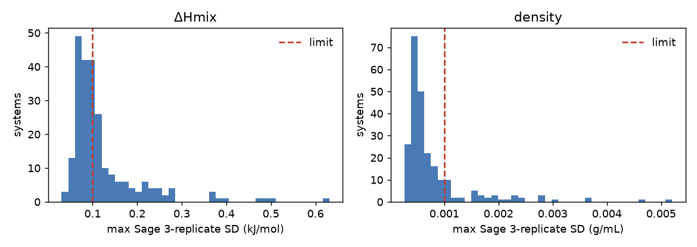

## Recommended fast-converging systems

| System | Points (ΔHmix/ρ) | Linear H^E (two-phase signature) | Slopes between points | Outcome |
|---|---|---|---|---|
| `CCO` + `O` | 3/3 | no | 1.244, 0.597 | excluded: Already covered by the [ethanol_water_density](https://github.com/ddmms/ml-peg/tree/8e52132f661fb3d46d5a245aa52b1d940ba22504/ml_peg/calcs/molecular_dynamics/ethanol_water_density) benchmark. |
| `C1CCNCC1` + `O` | 3/3 | no | -0.695, 2.700 | excluded: Dropped after the Sage reference run (2026-10-20). Nitrogen inversion is frozen in Sage (no axial/equatorial N-H interconversion in 2.2 ns, or in a 500 K anneal), and the real barrier (ΔG‡ = 6.1 kcal/mol ≈ 25 kJ/mol, [Anet and Yavari 1977](https://doi.org/10.1021/ja00450a064)) suggests ns lifetimes for MLIPs too, so ΔHmix depended on the starting N-H orientation by ~0.3 kJ/mol. It also showed the largest box-size gap against the published 1000-molecule Sage run (-0.35 kJ/mol at x = 0.25; [published openff-2.2.1 value](https://github.com/openforcefield/ash-sage-rc2/blob/00c9524d38af53725a1a18feb3433f5c191cdb4a/04_benchmark/phys-prop/output/training/summary-benchmarks-EnthalpyOfMixing.csv?plain=1#L4806)) and is microheterogeneous for x between 0.08 and 0.5 ([arXiv:2203.01224](https://arxiv.org/abs/2203.01224)). |
| `CO` + `O` | 3/3 | no | 0.365, 0.970 | selected |
| `O` + `O=C1CCCN1` | 3/3 | yes | -0.551, 1.277 | excluded: Viscous lactam that melts at ~25 °C ([PubChem](https://pubchem.ncbi.nlm.nih.gov/compound/12025#section=Melting-Point)). The Sage data sets and benchmarks encode it as the imidic acid tautomer OC1=NCCC1 (e.g. [Sage 2.0 training set](https://github.com/openforcefield/openff-sage/blob/a6a061ba8ebc144e3fda46f5f7a9e7a352b9cd2f/data-set-curation/physical-property/optimizations/data-sets/sage-train-v1.csv?plain=1#L145), [rc2 training set](https://github.com/openforcefield/ash-sage-rc2/blob/00c9524d38af53725a1a18feb3433f5c191cdb4a/01_download-data/physprop/final/output/training-set.csv?plain=1#L769), [rc2 benchmark, openff-2.0.0](https://github.com/openforcefield/ash-sage-rc2/blob/00c9524d38af53725a1a18feb3433f5c191cdb4a/04_benchmark/phys-prop/output/training/summary-benchmarks-EnthalpyOfMixing.csv?plain=1#L2843)), so the published Sage repeat SDs are for a different molecule. The rc2 enthalpy uncertainties are a flat 25 % placeholder (σ = 0.1695 for ΔHmix = -0.678 kJ/mol, [same rc2 row](https://github.com/openforcefield/ash-sage-rc2/blob/00c9524d38af53725a1a18feb3433f5c191cdb4a/01_download-data/physprop/final/output/training-set.csv?plain=1#L769)). |
| `O` + `c1ccncc1` | 3/0 | no | -0.766, 0.906 | selected |
| `CC(=O)c1ccccc1` + `O` | 3/0 | yes | 0.677, 0.671 | excluded: two-phase. Aqueous solubility is 6.13 g/L at 25 °C (x ≈ 0.001; Southworth and Keller 1986, via [PubChem](https://pubchem.ncbi.nlm.nih.gov/compound/7410#section=Solubility)), and the H^E slopes between x = 0.2, 0.5 and 0.8 are identical (0.677 and 0.671 kJ/mol), the lever-rule signature. The water content of the organic-rich phase was not found; confirm against the IUPAC-NIST Solubility Data Series. |
| `CC(=O)CC(C)=O` + `O` | 3/0 | yes | 0.840, 0.867 | excluded: two-phase. Binary mutual solubilities in ThermoML ([10.1016/j.fluid.2010.11.029](https://trc.nist.gov/ThermoML/10.1016/j.fluid.2010.11.029.json)): at 298.15 K the aqueous phase holds an acetylacetone mass fraction of 0.158 (x ≈ 0.033), and the organic phase holds 3–6 wt% water between 288 and 313 K (x(acetylacetone) ≈ 0.75–0.85). The measured compositions (x = 0.2–0.75) are therefore two-phase. |
| `CCOC(=O)CC(C)=O` + `O` | 3/0 | yes | 1.710, 1.469 | excluded: two-phase. Aqueous solubility is 2.86 g/100 mL at 20 °C (x ≈ 0.004; ICSC, via [PubChem](https://pubchem.ncbi.nlm.nih.gov/compound/8868#section=Solubility)). PubChem also lists 110 g/L at 17 °C (AQUASOL, x ≈ 0.016); the sources disagree and no primary measurement was checked, but either value puts x = 0.2 inside the two-phase region. H^E/x is roughly constant (slopes 1.71 and 1.47 kJ/mol); x = 0.75 may lie near the organic-rich phase boundary. |

- **acetophenone + water**: Aqueous solubility is 6.13 g/L at 25 °C (x ≈ 0.001; Southworth and Keller 1986, via [PubChem](https://pubchem.ncbi.nlm.nih.gov/compound/7410#section=Solubility)), and the H^E slopes between x = 0.2, 0.5 and 0.8 are identical (0.677 and 0.671 kJ/mol), the lever-rule signature. The water content of the organic-rich phase was not found; confirm against the IUPAC-NIST Solubility Data Series.
- **acetylacetone + water**: Binary mutual solubilities in ThermoML ([10.1016/j.fluid.2010.11.029](https://trc.nist.gov/ThermoML/10.1016/j.fluid.2010.11.029.json)): at 298.15 K the aqueous phase holds an acetylacetone mass fraction of 0.158 (x ≈ 0.033), and the organic phase holds 3–6 wt% water between 288 and 313 K (x(acetylacetone) ≈ 0.75–0.85). The measured compositions (x = 0.2–0.75) are therefore two-phase.
- **ethyl acetoacetate + water**: Aqueous solubility is 2.86 g/100 mL at 20 °C (x ≈ 0.004; ICSC, via [PubChem](https://pubchem.ncbi.nlm.nih.gov/compound/8868#section=Solubility)). PubChem also lists 110 g/L at 17 °C (AQUASOL, x ≈ 0.016); the sources disagree and no primary measurement was checked, but either value puts x = 0.2 inside the two-phase region. H^E/x is roughly constant (slopes 1.71 and 1.47 kJ/mol); x = 0.75 may lie near the organic-rich phase boundary.

## Selected systems

| # | System | T (K) | ΔHmix at box x (kJ/mol) | V^E at box x (cm³/mol) | Hard filters | Interaction |
|---|---|---|---|---|---|---|
| 1 | pyrrole + pyridine | 298.15 | -1.77 / -2.65 / -1.62 | -0.00 / 0.07 / 0.10 | pass | N-H···N hydrogen bond between an aromatic donor and acceptor |
| 2 | methanol + water | 298.15 | -0.80 / -0.78 / -0.58 | -0.62 / -1.00 / -0.81 | exception | alcohol-water hydrogen-bond network |
| 3 | water + pyridine | 303.15 | -1.13 / -1.28 / -1.10 | – / – / – | exception | aromatic nitrogen-water hydrogen bonding |
| 4 | N-methyl-2-pyrrolidone + 1,2-dichloroethane | 298.15 | -0.82 / -1.26 / -0.85 | -0.09 / -0.12 / -0.08 | exception | tertiary amide with a chloroalkane (C-H···O=C, dipolar) |
| 5 | 2-(dimethylamino)ethanol + methanol | 298.15 | -0.80 / -0.87 / -0.53 | -0.90 / -1.05 / -0.57 | pass | amino-alcohol with an alcohol (O-H···N and O-H···O) |
| 6 | acetone + N-methylaniline | 298.15 | -0.50 / -0.67 / -0.53 | -0.45 / -0.73 / -0.67 | pass | aromatic N-H donor with a ketone acceptor |
| 7 | methyl pentanoate + octane | 298.15 | 0.77 / 1.05 / 0.79 | 0.50 / 0.62 / 0.47 | pass | dilution of ester dipoles in an alkane |
| 8 | 1-propanol + benzene | 298.15 | 1.04 / 0.97 / 0.55 | 0.14 / 0.09 / 0.02 | pass | alcohol self-association broken by an aromatic (O-H···π) |
| 9 | tetrahydropyran + ethanol | 298.15 | 0.57 / 0.85 / 0.75 | -0.01 / 0.01 / 0.04 | pass | cyclic ether with an alcohol |
| 10 | dipropylamine + N,N-dimethylformamide | 298.15 | 0.61 / 0.75 / 0.53 | -0.25 / -0.29 / -0.21 | pass | secondary amine with a tertiary amide |
| 11 | propionitrile + tert-amyl ethyl ether | 298.15 | 0.50 / 0.70 / 0.59 | -0.22 / -0.37 / -0.33 | pass | nitrile dipoles diluted in an ether |
| 12 | 2-butanone + dibutylamine | 298.15 | 0.42 / 0.62 / 0.43 | 0.17 / 0.26 / 0.20 | pass | ketone with a secondary amine |
| 13 | heptane + toluene | 298.15 | 0.45 / 0.56 / 0.39 | 0.11 / 0.15 / 0.11 | pass | dispersion and π control (no polar groups) |

13 systems, 39 mixture boxes and 25 pure boxes (64 in total).

### Structures

Component a is the one whose mole fraction x is quoted.

| # | Component a | Component b |
|---|---|---|
| 1 | 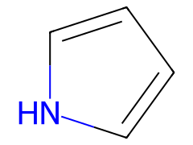<br>pyrrole<br>`c1cc[nH]c1` | <br>pyridine<br>`c1ccncc1` |
| 2 | 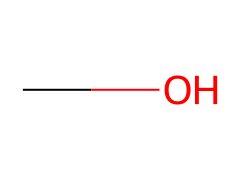<br>methanol<br>`CO` | <br>water<br>`O` |
| 3 | 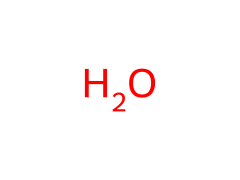<br>water<br>`O` | 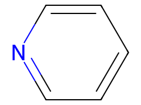<br>pyridine<br>`c1ccncc1` |
| 4 | 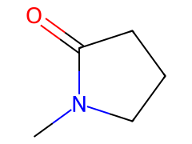<br>N-methyl-2-pyrrolidone<br>`CN1CCCC1=O` | 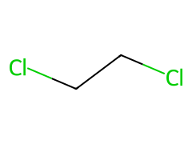<br>1,2-dichloroethane<br>`ClCCCl` |
| 5 | 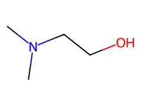<br>2-(dimethylamino)ethanol<br>`CN(C)CCO` | <br>methanol<br>`CO` |
| 6 | 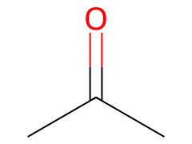<br>acetone<br>`CC(C)=O` | 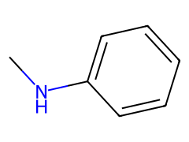<br>N-methylaniline<br>`CNc1ccccc1` |
| 7 | 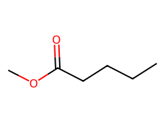<br>methyl pentanoate<br>`CCCCC(=O)OC` | 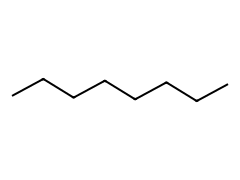<br>octane<br>`CCCCCCCC` |
| 8 | 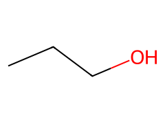<br>1-propanol<br>`CCCO` | 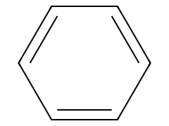<br>benzene<br>`c1ccccc1` |
| 9 | 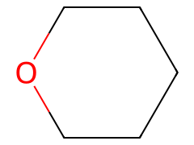<br>tetrahydropyran<br>`C1CCOCC1` | 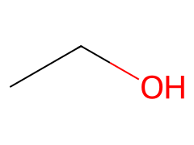<br>ethanol<br>`CCO` |
| 10 | 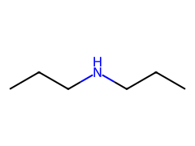<br>dipropylamine<br>`CCCNCCC` | 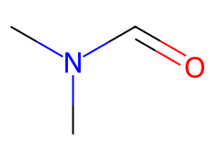<br>N,N-dimethylformamide<br>`CN(C)C=O` |
| 11 | 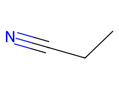<br>propionitrile<br>`CCC#N` | 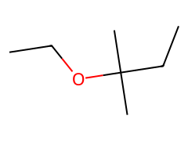<br>tert-amyl ethyl ether<br>`CCOC(C)(C)CC` |
| 12 | 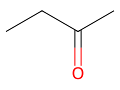<br>2-butanone<br>`CCC(C)=O` | 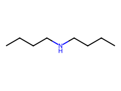<br>dibutylamine<br>`CCCCNCCCC` |
| 13 | 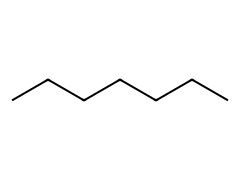<br>heptane<br>`CCCCCCC` | 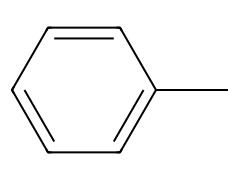<br>toluene<br>`Cc1ccccc1` |

### V^E coverage

V^E diversity was not a selection criterion. Sign at the three box compositions:

- negative: 6
- positive: 4
- sign change: 2
- no density data: 1

### Box plan

Boxes have edge ≥ 25.0 Å, ≥ 100 molecules and ≥ 20 minority molecules, with x within 0.01 of the measured composition. Evaluator, by comparison, uses a fixed total (1000 molecules for Sage), rounds x·N per component and only requires at least one molecule of each, so at the compositions used here its minority counts are about 200 or more.

Mixture boxes: 1144–2470 atoms (median 1495); total 62760 atoms across 39 boxes. Constraint that sets the size: edge 25, total 14.

| System | x (box) | Molecules a / b | Total | Atoms | Edge (Å) | Set by |
|---|---|---|---|---|---|---|
| pyrrole + pyridine | 0.240 | 29 / 92 | 121 | 1302 | 25.0 | edge |
| pyrrole + pyridine | 0.508 | 64 / 62 | 126 | 1322 | 25.1 | edge |
| pyrrole + pyridine | 0.763 | 100 / 31 | 131 | 1341 | 25.1 | edge |
| methanol + water | 0.199 | 86 / 346 | 432 | 1554 | 25.0 | edge |
| methanol + water | 0.500 | 168 / 168 | 336 | 1512 | 25.0 | edge |
| methanol + water | 0.701 | 202 / 86 | 288 | 1470 | 25.0 | edge |
| water + pyridine | 0.296 | 45 / 107 | 152 | 1312 | 25.1 | edge |
| water + pyridine | 0.495 | 94 / 96 | 190 | 1338 | 25.0 | edge |
| water + pyridine | 0.700 | 180 / 77 | 257 | 1387 | 25.0 | edge |
| N-methyl-2-pyrrolidone + 1,2-dichloroethane | 0.254 | 29 / 85 | 114 | 1144 | 25.0 | edge |
| N-methyl-2-pyrrolidone + 1,2-dichloroethane | 0.500 | 54 / 54 | 108 | 1296 | 25.1 | edge |
| N-methyl-2-pyrrolidone + 1,2-dichloroethane | 0.740 | 77 / 27 | 104 | 1448 | 25.1 | edge |
| 2-(dimethylamino)ethanol + methanol | 0.247 | 41 / 125 | 166 | 1447 | 25.0 | edge |
| 2-(dimethylamino)ethanol + methanol | 0.500 | 65 / 65 | 130 | 1495 | 25.1 | edge |
| 2-(dimethylamino)ethanol + methanol | 0.750 | 81 / 27 | 108 | 1539 | 25.0 | edge |
| acetone + N-methylaniline | 0.230 | 23 / 77 | 100 | 1539 | 25.6 | total |
| acetone + N-methylaniline | 0.505 | 51 / 50 | 101 | 1360 | 25.1 | edge |
| acetone + N-methylaniline | 0.709 | 78 / 32 | 110 | 1324 | 25.0 | edge |
| methyl pentanoate + octane | 0.230 | 23 / 77 | 100 | 2462 | 29.6 | total |
| methyl pentanoate + octane | 0.490 | 49 / 51 | 100 | 2306 | 29.1 | total |
| methyl pentanoate + octane | 0.730 | 73 / 27 | 100 | 2162 | 28.6 | total |
| 1-propanol + benzene | 0.245 | 27 / 83 | 110 | 1320 | 25.1 | edge |
| 1-propanol + benzene | 0.500 | 57 / 57 | 114 | 1368 | 25.1 | edge |
| 1-propanol + benzene | 0.750 | 90 / 30 | 120 | 1440 | 25.0 | edge |
| tetrahydropyran + ethanol | 0.250 | 34 / 102 | 136 | 1462 | 25.0 | edge |
| tetrahydropyran + ethanol | 0.504 | 60 / 59 | 119 | 1491 | 25.0 | edge |
| tetrahydropyran + ethanol | 0.755 | 80 / 26 | 106 | 1514 | 25.0 | edge |
| dipropylamine + N,N-dimethylformamide | 0.248 | 26 / 79 | 105 | 1520 | 25.1 | edge |
| dipropylamine + N,N-dimethylformamide | 0.500 | 50 / 50 | 100 | 1700 | 26.1 | total |
| dipropylamine + N,N-dimethylformamide | 0.750 | 75 / 25 | 100 | 1950 | 27.3 | total |
| propionitrile + tert-amyl ethyl ether | 0.200 | 20 / 80 | 100 | 2100 | 28.3 | total |
| propionitrile + tert-amyl ethyl ether | 0.500 | 50 / 50 | 100 | 1650 | 26.4 | total |
| propionitrile + tert-amyl ethyl ether | 0.700 | 70 / 30 | 100 | 1350 | 25.1 | edge |
| 2-butanone + dibutylamine | 0.220 | 22 / 78 | 100 | 2470 | 29.4 | total |
| 2-butanone + dibutylamine | 0.500 | 50 / 50 | 100 | 2050 | 27.9 | total |
| 2-butanone + dibutylamine | 0.790 | 79 / 21 | 100 | 1615 | 26.1 | total |
| heptane + toluene | 0.250 | 25 / 75 | 100 | 1700 | 26.9 | total |
| heptane + toluene | 0.500 | 50 / 50 | 100 | 1900 | 27.6 | total |
| heptane + toluene | 0.750 | 75 / 25 | 100 | 2100 | 28.4 | total |

## Sage baseline (published, 1000-molecule boxes)

| System | Max rep. SD ΔHmix | Max rep. SD ρ | openff-2.0.0 ΔHmix MAE | openff-2.1.0 ΔHmix MAE | openff-2.2.1 ΔHmix MAE | openff-2.3.0rc1 ΔHmix MAE | openff-2.2.1 ρ MAE |
|---|---|---|---|---|---|---|---|
| pyrrole + pyridine | 0.078 | 0.0005 | 1.905 | 1.922 | 1.930 | 2.023 | 0.0053 |
| methanol + water | 0.030 | 0.0010 | 0.815 | 0.826 | 0.825 | 0.833 | 0.0396 |
| water + pyridine | – | – | – | – | – | – | – |
| N-methyl-2-pyrrolidone + 1,2-dichloroethane | 0.062 | 0.0008 | 0.520 | 0.520 | 0.454 | 0.577 | 0.0216 |
| 2-(dimethylamino)ethanol + methanol | 0.075 | 0.0005 | 0.069 | 0.326 | 0.393 | 0.171 | 0.0087 |
| acetone + N-methylaniline | 0.091 | 0.0004 | 0.024 | 0.126 | 0.172 | 0.088 | 0.0055 |
| methyl pentanoate + octane | 0.083 | 0.0004 | 0.366 | 0.275 | 0.277 | 0.274 | 0.0073 |
| 1-propanol + benzene | 0.075 | 0.0004 | 0.212 | 0.195 | 0.227 | 0.292 | 0.0131 |
| tetrahydropyran + ethanol | 0.077 | 0.0005 | 0.047 | 0.096 | 0.084 | 0.154 | 0.0089 |
| dipropylamine + N,N-dimethylformamide | 0.069 | 0.0004 | 0.375 | 0.483 | 0.473 | 0.407 | 0.0087 |
| propionitrile + tert-amyl ethyl ether | 0.061 | 0.0003 | 0.286 | 0.355 | 0.347 | 0.382 | 0.0003 |
| 2-butanone + dibutylamine | 0.093 | 0.0004 | 0.281 | 0.246 | 0.286 | 0.283 | 0.0097 |
| heptane + toluene | 0.076 | 0.0006 | 0.137 | 0.124 | 0.140 | 0.168 | 0.0163 |

## Pure densities

Each pure density is taken from the paper that supplies most of the mixture densities, so V^E is self-consistent, unless an explicit reference is given (water from [IAPWS-95](https://doi.org/10.1063/1.1461829)). Other sources disagreeing by more than 0.002 g/mL are listed.

| Component | T (K) | ρ (g/mL) | σ | Source | In ml-peg | ml-peg value | Disagreeing sources |
|---|---|---|---|---|---|---|---|
| `c1cc[nH]c1` | 298.15 | 0.96554 | 0.00006 | thermoml:10.1016/j.fluid.2013.10.029 | no | – | – |
| `c1ccncc1` | 298.15 | 0.97801 | 0.00006 | thermoml:10.1016/j.fluid.2013.10.029 | yes | 0.9819 @ 298 K | thermoml:10.1016/j.fluid.2015.04.031, sage-2.0-train:10.1016/j.fluid.2015.04.031, ml-peg |
| `CO` | 298.15 | 0.78657 | 0.00012 | thermoml:10.1021/je700300y | yes | 0.7914 @ 298 K | ml-peg |
| `O` | 298.15 | 0.99705 | 0.00000 | IAPWS-95 (Wagner and Pruss, J. Phys. Chem. Ref. Data 31, 387 (2002)) | yes | 0.9980 @ 298 K | – |
| `O` | 303.15 | 0.99565 | 0.00000 | IAPWS-95 (Wagner and Pruss, J. Phys. Chem. Ref. Data 31, 387 (2002)) | yes | 0.9980 @ 298 K | – |
| `c1ccncc1` | 303.15 | 0.97298 | 0.00011 | thermoml:10.1021/je900874z | yes | 0.9819 @ 298 K | – |
| `CN1CCCC1=O` | 298.15 | 1.02800 | 0.00015 | thermoml:10.1021/je7003758 | yes | 1.0230 @ 303 K | thermoml:10.1016/j.fluid.2008.02.023, rc2-validation:10.1016/j.fluid.2008.02.023 |
| `ClCCCl` | 298.15 | 1.24550 | 0.00030 | thermoml:10.1021/je7003758 | yes | 1.2454 @ 303 K | – |
| `CN(C)CCO` | 298.15 | 0.88334 | 0.00020 | thermoml:10.1016/j.tca.2014.03.038 | no | – | – |
| `CC(C)=O` | 298.15 | 0.78532 | 0.00025 | thermoml:10.1021/je900874z | yes | 0.7845 @ 303 K | – |
| `CNc1ccccc1` | 298.15 | 0.98207 | 0.00047 | thermoml:10.1021/je900874z | no | – | – |
| `CCCCC(=O)OC` | 298.15 | 0.88484 | 0.00050 | thermoml:10.1021/acs.jced.5b00813 | no | – | – |
| `CCCCCCCC` | 298.15 | 0.69858 | 0.00052 | thermoml:10.1021/acs.jced.5b00813 | no | – | – |
| `CCCO` | 298.15 | 0.79969 | 0.00013 | thermoml:10.1021/je700254t | yes | 0.7997 @ 303 K | thermoml:10.1021/je900212d, rc2-validation:10.1021/je900212d |
| `c1ccccc1` | 298.15 | 0.87358 | 0.00008 | thermoml:10.1021/je700254t | yes | 0.8765 @ 298 K | ml-peg |
| `C1CCOCC1` | 298.15 | 0.87903 | 0.00004 | thermoml:10.1021/je201140q | no | – | – |
| `CCO` | 298.15 | 0.78511 | 0.00006 | thermoml:10.1021/je201140q | yes | 0.7893 @ 298 K | ml-peg |
| `CCCNCCC` | 298.15 | 0.73362 | 0.00089 | thermoml:10.1021/acs.jced.5b00802 | no | – | – |
| `CN(C)C=O` | 298.15 | 0.94408 | 0.00113 | thermoml:10.1021/acs.jced.5b00802 | yes | 0.9445 @ 303 K | thermoml:10.1007/s10765-016-2096-3, rc2-validation:10.1007/s10765-016-2096-3 |
| `CCC#N` | 298.15 | 0.77600 | 0.00015 | thermoml:10.1021/je301238f | no | – | – |
| `CCOC(C)(C)CC` | 298.15 | 0.76100 | 0.00015 | thermoml:10.1021/je301238f | no | – | – |
| `CCC(C)=O` | 298.15 | 0.80008 | 0.00009 | thermoml:10.1016/j.tca.2010.09.004 | yes | 0.7999 @ 303 K | – |
| `CCCCNCCCC` | 298.15 | 0.75546 | 0.00010 | thermoml:10.1016/j.tca.2010.09.004 | no | – | thermoml:10.1021/je800026p, rc2-validation:10.1021/je800026p |
| `CCCCCCC` | 298.15 | 0.67954 | 0.00013 | thermoml:10.1021/je400184t | no | – | – |
| `Cc1ccccc1` | 298.15 | 0.86222 | 0.00011 | thermoml:10.1021/je400184t | yes | 0.8668 @ 298 K | ml-peg |

Many ml-peg liquid_densities references appear to be measured about 5 K below their labelled temperature (20 °C values labelled 298 K, 25 °C values labelled 303 K), so they are not used here; see [`docs/data_issues.md`](../docs/data_issues.md) section 1.1. Pure densities of components already in ml-peg are simulated (needed for ΔHmix) but not re-scored.

## Per-system details

### 1. pyrrole + pyridine (`c1cc[nH]c1` + `c1ccncc1`)

- **Interaction:** N-H···N hydrogen bond between an aromatic donor and acceptor
- **Rationale:** Largest exothermic signal in the pool (-2.65 kJ/mol), single source paper for both properties, and Sage gets it badly wrong (MAE 1.9 kJ/mol).
- **Miscibility:** Single liquid phase across the whole composition range in the source papers (see the single-phase evidence below).
- **ΔHmix data:** 38 points from 10.1016/j.fluid.2013.10.029 (38)
- **Density data:** 15 points from 10.1016/j.fluid.2013.10.029 (15)
- **Single-phase evidence:** ΔHmix measured at 38 compositions spanning x = 0.03–0.97; straight-line fit reduced χ² = 918 (a two-phase region would give ≈ 1).

| x box | n_a / n_b | atoms | edge (Å) | ΔHmix ± σ (kJ/mol) | ρ ± σ (g/mL) | V^E (cm³/mol) |
|---|---|---|---|---|---|---|
| 0.240 | 29 / 92 | 1302 | 25.0 | -1.767 ± 0.0115 | 0.9754 ± 0.00006 | -0.001 |
| 0.508 | 64 / 62 | 1322 | 25.1 | -2.650 ± 0.0164 | 0.9712 ± 0.00006 | 0.073 |
| 0.763 | 100 / 31 | 1341 | 25.1 | -1.625 ± 0.0107 | 0.9675 ± 0.00006 | 0.098 |

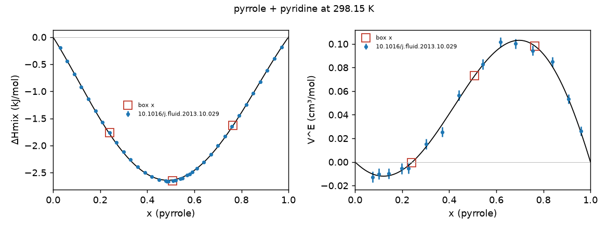

### 2. methanol + water (`CO` + `O`)

- **Interaction:** alcohol-water hydrogen-bond network
- **Rationale:** Smallest Sage repeat spread in the pool (0.03 kJ/mol), so it calibrates the noise of the protocol. Methanol and water pure densities are already scored in [ml-peg](https://github.com/ddmms/ml-peg/tree/8e52132f661fb3d46d5a245aa52b1d940ba22504/ml_peg/calcs/molecular_dynamics/liquid_densities) and are not re-scored.
- **Miscibility:** Miscible in all proportions.
- **Filter exception:** Aqueous exception to rules 1 and 2. The rc2 density and enthalpy compositions differ by 0.06 in x (full ThermoML isotherms remove the mismatch), and water's pure density comes from [IAPWS-95](https://doi.org/10.1063/1.1461829).
- **Failed filters:** composition mismatch; missing pure density with uncertainty
- **ΔHmix data:** 11 points from 10.1016/j.tca.2006.02.028 (11)
- **Density data:** 23 points from 10.1021/je700300y (12), 10.1016/j.jct.2007.05.004 (11)
- **Single-phase evidence:** ΔHmix measured at 11 compositions spanning x = 0.05–0.90; straight-line fit reduced χ² = 202 (a two-phase region would give ≈ 1).

| x box | n_a / n_b | atoms | edge (Å) | ΔHmix ± σ (kJ/mol) | ρ ± σ (g/mL) | V^E (cm³/mol) |
|---|---|---|---|---|---|---|
| 0.199 | 86 / 346 | 1554 | 25.0 | -0.805 ± 0.0045 | 0.9473 ± 0.00006 | -0.615 |
| 0.500 | 168 / 168 | 1512 | 25.0 | -0.777 ± 0.0045 | 0.8813 ± 0.00009 | -1.003 |
| 0.701 | 202 / 86 | 1470 | 25.0 | -0.581 ± 0.0035 | 0.8401 ± 0.00010 | -0.811 |

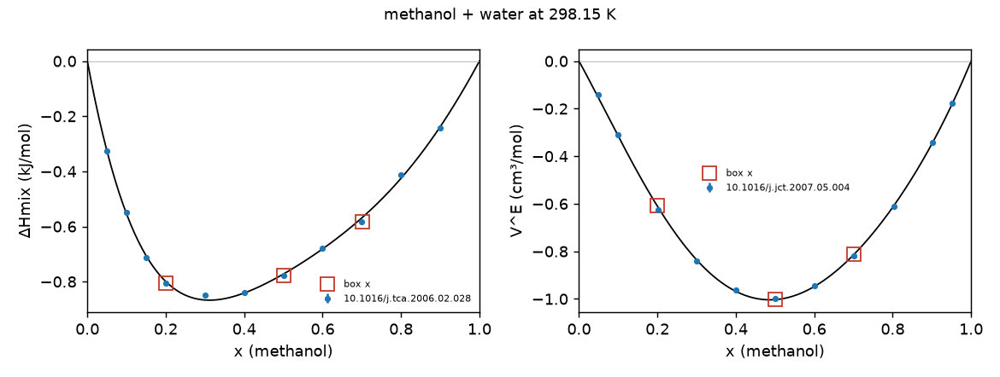

### 3. water + pyridine (`O` + `c1ccncc1`)

- **Interaction:** aromatic nitrogen-water hydrogen bonding
- **Rationale:** Only aromatic-water system available; relevant to biomolecular recognition.
- **Miscibility:** Miscible in all proportions at 303 K (enthalpies measured across x = 0.1–0.9).
- **Filter exception:** Aqueous exception: the only data are at 303.15 K (the [ThermoML record](https://trc.nist.gov/ThermoML/10.1021/je2002495.json) stores 298.15 K, but the [paper's title](https://doi.org/10.1021/je2002495) gives 303.15 K) and there are no published Sage repeat errors (no pyridine + water rows in the [rc2 benchmark outputs](https://github.com/openforcefield/ash-sage-rc2/tree/00c9524d38af53725a1a18feb3433f5c191cdb4a/04_benchmark/phys-prop/output)). Enthalpy only unless ThermoML provides a 303.15 K mixture density. MAZE uses our own Sage replicates.
- **ΔHmix data:** 9 points from 10.1021/je2002495 (9)
- **Density data:** 0 points from none
- **Single-phase evidence:** ΔHmix measured at 9 compositions spanning x = 0.10–0.91; straight-line fit reduced χ² = 344 (a two-phase region would give ≈ 1).

| x box | n_a / n_b | atoms | edge (Å) | ΔHmix ± σ (kJ/mol) | ρ ± σ (g/mL) | V^E (cm³/mol) |
|---|---|---|---|---|---|---|
| 0.296 | 45 / 107 | 1312 | 25.1 | -1.127 ± 0.0341 | – ± – | – |
| 0.495 | 94 / 96 | 1338 | 25.0 | -1.281 ± 0.0387 | – ± – | – |
| 0.700 | 180 / 77 | 1387 | 25.0 | -1.097 ± 0.0331 | – ± – | – |

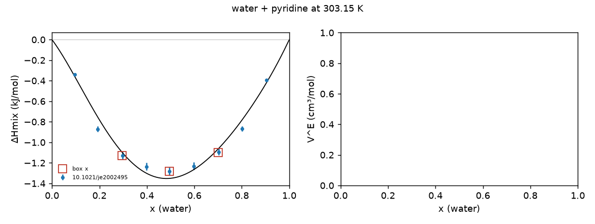

### 4. N-methyl-2-pyrrolidone + 1,2-dichloroethane (`CN1CCCC1=O` + `ClCCCl`)

- **Interaction:** tertiary amide with a chloroalkane (C-H···O=C, dipolar)
- **Rationale:** Widens the exothermic range (-1.26 kJ/mol) and covers chlorine. Both pure densities are already in [ml-peg](https://github.com/ddmms/ml-peg/tree/8e52132f661fb3d46d5a245aa52b1d940ba22504/ml_peg/calcs/molecular_dynamics/liquid_densities).
- **Miscibility:** Single liquid phase across the whole composition range in the source papers (see the single-phase evidence below).
- **Filter exception:** Fails rule 1 by a hair on the 3-point rc2 subsets (|dx| = 0.0503 vs 0.05). The full ThermoML isotherms remove the mismatch.
- **Failed filters:** composition mismatch
- **ΔHmix data:** 26 points from 10.1021/je020065c (15), 10.1016/j.jct.2008.01.024 (11)
- **Density data:** 9 points from 10.1021/je7003758 (9)
- **Single-phase evidence:** ΔHmix measured at 26 compositions spanning x = 0.04–0.96; straight-line fit reduced χ² = 714 (a two-phase region would give ≈ 1).

| x box | n_a / n_b | atoms | edge (Å) | ΔHmix ± σ (kJ/mol) | ρ ± σ (g/mL) | V^E (cm³/mol) |
|---|---|---|---|---|---|---|
| 0.254 | 29 / 85 | 1144 | 25.0 | -0.815 ± 0.0152 | 1.1831 ± 0.00025 | -0.094 |
| 0.500 | 54 / 54 | 1296 | 25.1 | -1.264 ± 0.0055 | 1.1278 ± 0.00020 | -0.120 |
| 0.740 | 77 / 27 | 1448 | 25.1 | -0.849 ± 0.0160 | 1.0777 ± 0.00020 | -0.085 |

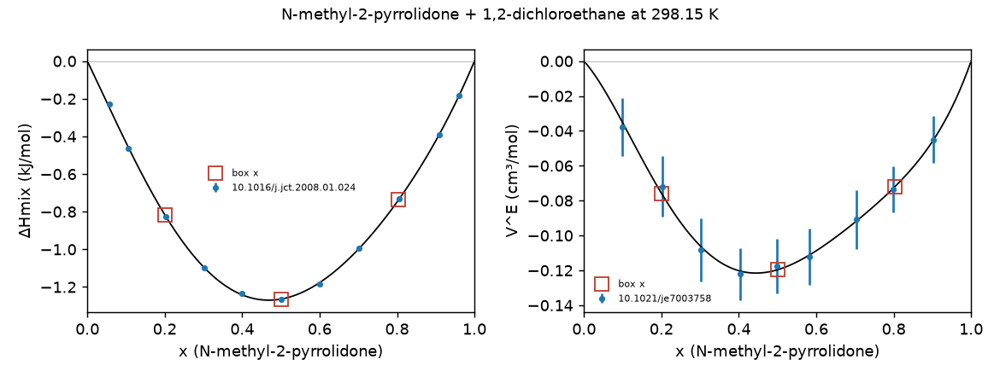

### 5. 2-(dimethylamino)ethanol + methanol (`CN(C)CCO` + `CO`)

- **Interaction:** amino-alcohol with an alcohol (O-H···N and O-H···O)
- **Rationale:** Exothermic cross-association between a bifunctional donor/acceptor and an alcohol.
- **Miscibility:** Single liquid phase across the whole composition range in the source papers (see the single-phase evidence below).
- **ΔHmix data:** 19 points from 10.1021/je800334m (19)
- **Density data:** 9 points from 10.1016/j.tca.2014.03.038 (9)
- **Single-phase evidence:** ΔHmix measured at 19 compositions spanning x = 0.05–0.95; straight-line fit reduced χ² = 291 (a two-phase region would give ≈ 1).

| x box | n_a / n_b | atoms | edge (Å) | ΔHmix ± σ (kJ/mol) | ρ ± σ (g/mL) | V^E (cm³/mol) |
|---|---|---|---|---|---|---|
| 0.247 | 41 / 125 | 1447 | 25.0 | -0.804 ± 0.0087 | 0.8437 ± 0.00014 | -0.897 |
| 0.500 | 65 / 65 | 1495 | 25.1 | -0.865 ± 0.0094 | 0.8684 ± 0.00015 | -1.048 |
| 0.750 | 81 / 27 | 1539 | 25.0 | -0.533 ± 0.0059 | 0.8777 ± 0.00017 | -0.566 |

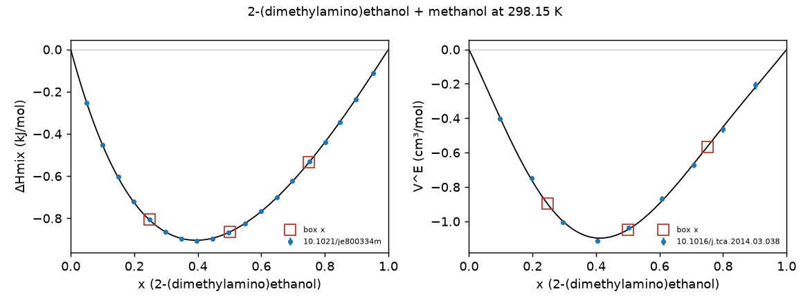

### 6. acetone + N-methylaniline (`CC(C)=O` + `CNc1ccccc1`)

- **Interaction:** aromatic N-H donor with a ketone acceptor
- **Rationale:** Exothermic N-H···O=C association; adds an aromatic amine.
- **Miscibility:** Single liquid phase across the whole composition range in the source papers (see the single-phase evidence below).
- **ΔHmix data:** 9 points from 10.1021/je200333p (9)
- **Density data:** 19 points from 10.1021/je900874z (19)
- **Single-phase evidence:** ΔHmix measured at 9 compositions spanning x = 0.13–0.90; straight-line fit reduced χ² = 393 (a two-phase region would give ≈ 1).

| x box | n_a / n_b | atoms | edge (Å) | ΔHmix ± σ (kJ/mol) | ρ ± σ (g/mL) | V^E (cm³/mol) |
|---|---|---|---|---|---|---|
| 0.230 | 23 / 77 | 1539 | 25.6 | -0.498 ± 0.0055 | 0.9532 ± 0.00035 | -0.450 |
| 0.505 | 51 / 50 | 1360 | 25.1 | -0.673 ± 0.0075 | 0.9089 ± 0.00026 | -0.730 |
| 0.709 | 78 / 32 | 1324 | 25.0 | -0.526 ± 0.0055 | 0.8664 ± 0.00023 | -0.672 |

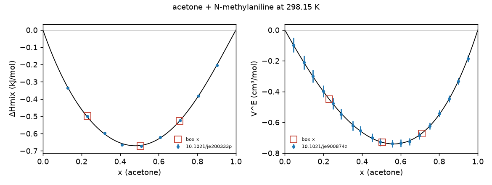

### 7. methyl pentanoate + octane (`CCCCC(=O)OC` + `CCCCCCCC`)

- **Interaction:** dilution of ester dipoles in an alkane
- **Rationale:** Endothermic dipole dilution, neither component in ml-peg.
- **Miscibility:** Single liquid phase across the whole composition range in the source papers (see the single-phase evidence below). Endothermic ester + alkane; check the demixing diagnostic in the pilot.
- **ΔHmix data:** 19 points from 10.1021/acs.jced.5b00813 (19)
- **Density data:** 19 points from 10.1021/acs.jced.5b00813 (19)
- **Single-phase evidence:** ΔHmix measured at 19 compositions spanning x = 0.07–0.96; straight-line fit reduced χ² = 656 (a two-phase region would give ≈ 1).

| x box | n_a / n_b | atoms | edge (Å) | ΔHmix ± σ (kJ/mol) | ρ ± σ (g/mL) | V^E (cm³/mol) |
|---|---|---|---|---|---|---|
| 0.230 | 23 / 77 | 2462 | 29.6 | 0.769 ± 0.0080 | 0.7323 ± 0.00051 | 0.499 |
| 0.490 | 49 / 51 | 2306 | 29.1 | 1.053 ± 0.0115 | 0.7764 ± 0.00051 | 0.616 |
| 0.730 | 73 / 27 | 2162 | 28.6 | 0.789 ± 0.0085 | 0.8234 ± 0.00051 | 0.465 |

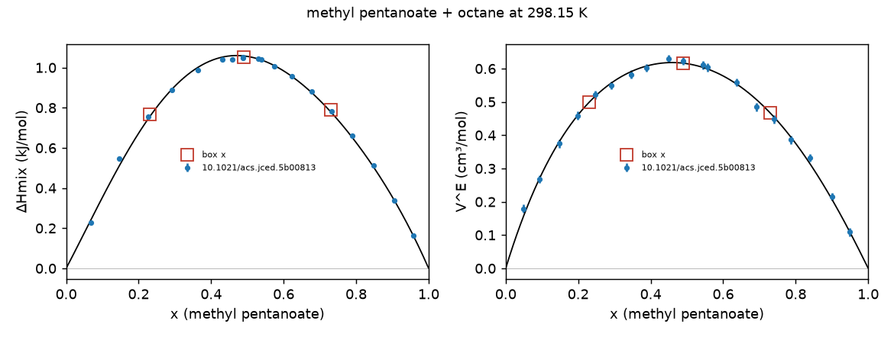

### 8. 1-propanol + benzene (`CCCO` + `c1ccccc1`)

- **Interaction:** alcohol self-association broken by an aromatic (O-H···π)
- **Rationale:** Alcohol dilution case that also probes O-H···π, replacing isooctane + 1-propanol. Both pure densities are already in [ml-peg](https://github.com/ddmms/ml-peg/tree/8e52132f661fb3d46d5a245aa52b1d940ba22504/ml_peg/calcs/molecular_dynamics/liquid_densities).
- **Miscibility:** Single liquid phase across the whole composition range in the source papers (see the single-phase evidence below).
- **ΔHmix data:** 19 points from 10.1016/j.jct.2015.01.003 (19)
- **Density data:** 18 points from 10.1021/je700254t (18)
- **Single-phase evidence:** ΔHmix measured at 19 compositions spanning x = 0.05–0.95; straight-line fit reduced χ² = 142 (a two-phase region would give ≈ 1).

| x box | n_a / n_b | atoms | edge (Å) | ΔHmix ± σ (kJ/mol) | ρ ± σ (g/mL) | V^E (cm³/mol) |
|---|---|---|---|---|---|---|
| 0.245 | 27 / 83 | 1320 | 25.1 | 1.039 ± 0.0065 | 0.8563 ± 0.00009 | 0.138 |
| 0.500 | 57 / 57 | 1368 | 25.1 | 0.968 ± 0.0065 | 0.8389 ± 0.00010 | 0.091 |
| 0.750 | 90 / 30 | 1440 | 25.0 | 0.551 ± 0.0060 | 0.8205 ± 0.00011 | 0.016 |

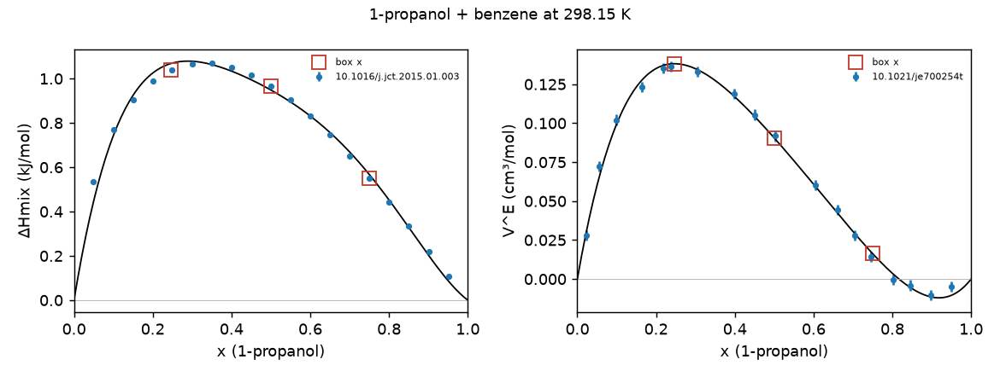

### 9. tetrahydropyran + ethanol (`C1CCOCC1` + `CCO`)

- **Interaction:** cyclic ether with an alcohol
- **Rationale:** Endothermic; ether acceptor competes with alcohol self-association.
- **Miscibility:** Single liquid phase across the whole composition range in the source papers (see the single-phase evidence below).
- **ΔHmix data:** 19 points from 10.1021/je049852v (19)
- **Density data:** 11 points from 10.1021/je201140q (11)
- **Single-phase evidence:** ΔHmix measured at 19 compositions spanning x = 0.05–0.95; straight-line fit reduced χ² = 374 (a two-phase region would give ≈ 1).

| x box | n_a / n_b | atoms | edge (Å) | ΔHmix ± σ (kJ/mol) | ρ ± σ (g/mL) | V^E (cm³/mol) |
|---|---|---|---|---|---|---|
| 0.250 | 34 / 102 | 1462 | 25.0 | 0.570 ± 0.0055 | 0.8189 ± 0.00013 | -0.015 |
| 0.504 | 60 / 59 | 1491 | 25.0 | 0.851 ± 0.0079 | 0.8441 ± 0.00010 | 0.014 |
| 0.755 | 80 / 26 | 1514 | 25.0 | 0.747 ± 0.0071 | 0.8633 ± 0.00008 | 0.044 |

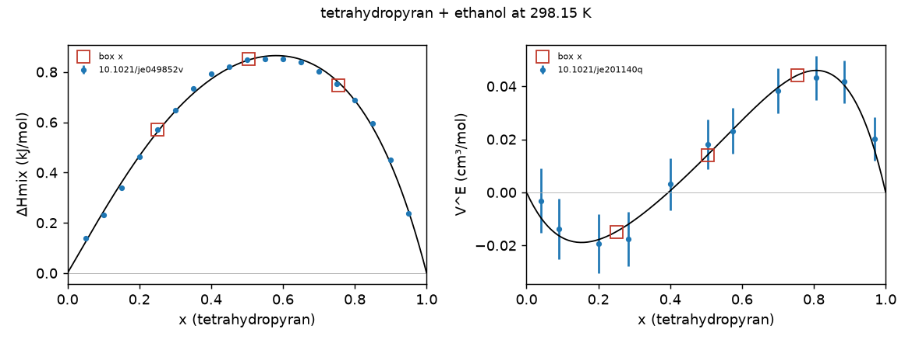

### 10. dipropylamine + N,N-dimethylformamide (`CCCNCCC` + `CN(C)C=O`)

- **Interaction:** secondary amine with a tertiary amide
- **Rationale:** Endothermic amine/amide pair; dipropylamine is new to ml-peg.
- **Miscibility:** Single liquid phase across the whole composition range in the source papers (see the single-phase evidence below).
- **ΔHmix data:** 19 points from 10.1016/j.fluid.2019.112283 (19)
- **Density data:** 15 points from 10.1021/acs.jced.5b00802 (15)
- **Single-phase evidence:** ΔHmix measured at 19 compositions spanning x = 0.05–0.96; straight-line fit reduced χ² = 99 (a two-phase region would give ≈ 1).

| x box | n_a / n_b | atoms | edge (Å) | ΔHmix ± σ (kJ/mol) | ρ ± σ (g/mL) | V^E (cm³/mol) |
|---|---|---|---|---|---|---|
| 0.248 | 26 / 79 | 1520 | 25.1 | 0.612 ± 0.0195 | 0.8687 ± 0.00106 | -0.253 |
| 0.500 | 50 / 50 | 1700 | 26.1 | 0.748 ± 0.0225 | 0.8115 ± 0.00099 | -0.289 |
| 0.750 | 75 / 25 | 1950 | 27.3 | 0.528 ± 0.0170 | 0.7681 ± 0.00094 | -0.208 |

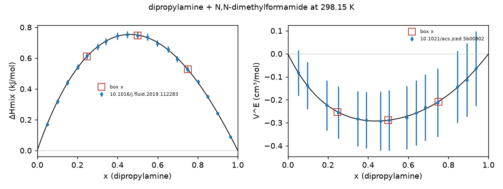

### 11. propionitrile + tert-amyl ethyl ether (`CCC#N` + `CCOC(C)(C)CC`)

- **Interaction:** nitrile dipoles diluted in an ether
- **Rationale:** Only nitrile system; both properties from one paper at identical compositions (data at 298.4 K). Neither component in ml-peg.
- **Miscibility:** Single liquid phase across the whole composition range in the source papers (see the single-phase evidence below).
- **ΔHmix data:** 9 points from 10.1021/je301238f (9)
- **Density data:** 9 points from 10.1021/je301238f (9)
- **Single-phase evidence:** ΔHmix measured at 9 compositions spanning x = 0.10–0.90; straight-line fit reduced χ² = 398 (a two-phase region would give ≈ 1).

| x box | n_a / n_b | atoms | edge (Å) | ΔHmix ± σ (kJ/mol) | ρ ± σ (g/mL) | V^E (cm³/mol) |
|---|---|---|---|---|---|---|
| 0.200 | 20 / 80 | 2100 | 28.3 | 0.501 ± 0.0069 | 0.7638 ± 0.00025 | -0.217 |
| 0.500 | 50 / 50 | 1650 | 26.4 | 0.703 ± 0.0095 | 0.7683 ± 0.00035 | -0.371 |
| 0.700 | 70 / 30 | 1350 | 25.1 | 0.588 ± 0.0080 | 0.7715 ± 0.00040 | -0.330 |

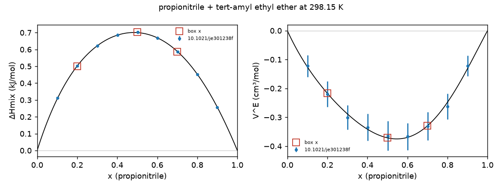

### 12. 2-butanone + dibutylamine (`CCC(C)=O` + `CCCCNCCCC`)

- **Interaction:** ketone with a secondary amine
- **Rationale:** Non-alcohol endothermic system, replacing methyl pentanoate + methanol.
- **Miscibility:** Single liquid phase across the whole composition range in the source papers (see the single-phase evidence below).
- **ΔHmix data:** 9 points from 10.1016/j.fluid.2013.01.011 (9)
- **Density data:** 19 points from 10.1016/j.tca.2010.09.004 (19)
- **Single-phase evidence:** ΔHmix measured at 9 compositions spanning x = 0.12–0.89; straight-line fit reduced χ² = 324 (a two-phase region would give ≈ 1).

| x box | n_a / n_b | atoms | edge (Å) | ΔHmix ± σ (kJ/mol) | ρ ± σ (g/mL) | V^E (cm³/mol) |
|---|---|---|---|---|---|---|
| 0.220 | 22 / 78 | 2470 | 29.4 | 0.423 ± 0.0045 | 0.7604 ± 0.00010 | 0.172 |
| 0.500 | 50 / 50 | 2050 | 27.9 | 0.619 ± 0.0065 | 0.7693 ± 0.00010 | 0.260 |
| 0.790 | 79 / 21 | 1615 | 26.1 | 0.428 ± 0.0045 | 0.7837 ± 0.00010 | 0.197 |

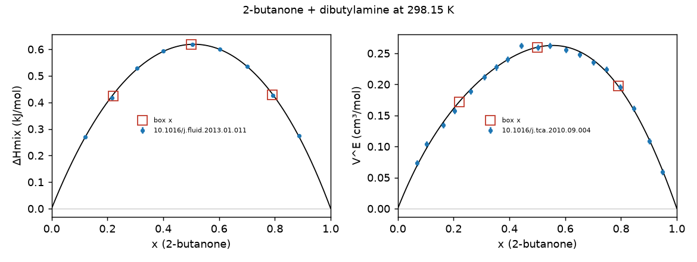

### 13. heptane + toluene (`CCCCCCC` + `Cc1ccccc1`)

- **Interaction:** dispersion and π control (no polar groups)
- **Rationale:** Non-polar control that separates dispersion/D3 errors from hydrogen-bond errors. Sage handles it well (MAE 0.14 kJ/mol).
- **Miscibility:** Fully miscible hydrocarbons. Single liquid phase across the whole composition range in the source papers (see the single-phase evidence below).
- **ΔHmix data:** 187 points from 10.1021/je400184t (168), 10.1016/j.jct.2008.12.004 (19)
- **Density data:** 15 points from 10.1021/je400184t (15)
- **Single-phase evidence:** ΔHmix measured at 187 compositions spanning x = 0.01–0.99; straight-line fit reduced χ² = 514 (a two-phase region would give ≈ 1).
- **Density points not used for V^E** (σ > 0.002 g/mL): 10.1016/j.jct.2005.10.011 (10)

| x box | n_a / n_b | atoms | edge (Å) | ΔHmix ± σ (kJ/mol) | ρ ± σ (g/mL) | V^E (cm³/mol) |
|---|---|---|---|---|---|---|
| 0.250 | 25 / 75 | 1700 | 26.9 | 0.451 ± 0.0030 | 0.8039 ± 0.00011 | 0.114 |
| 0.500 | 50 / 50 | 1900 | 27.6 | 0.556 ± 0.0036 | 0.7554 ± 0.00012 | 0.146 |
| 0.750 | 75 / 25 | 2100 | 28.4 | 0.391 ± 0.0026 | 0.7145 ± 0.00013 | 0.109 |

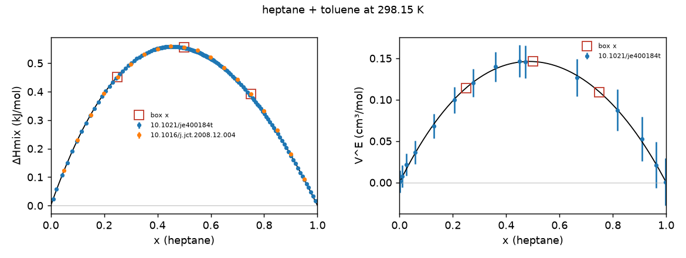

## Known gaps

- **No N-H (secondary) amide.** Systems with N-methylformamide, N-methylacetamide, acetamide or formamide in the Sage sets:

  - `CNC=O` + `Cc1ccccc1N`: 6 points (0 with uncertainties) from sage-2.0-train
  - `C1CCOCC1` + `CNC=O`: 6 points (0 with uncertainties) from sage-2.0-train
  - `CNC=O` + `Cc1ccccc1Cl`: 6 points (0 with uncertainties) from sage-2.0-train

  The Sage 2.0 set drops their uncertainties and has enthalpies only at 308.15 K, but the ThermoML records carry full uncertainties (and the standard-InChI conversion would otherwise turn N-methylformamide into `CN=CO`; `thermoml.py` repairs amide tautomers). See candidate additions.
- **No amide-water system.** 2-pyrrolidone + water was dropped (see below).
- **Selection bias.** Every system comes from the Sage training/validation pools, so the set reflects ThermoML coverage and Sage's curation choices rather than a designed spread.
- **Endothermic range is capped** at RT/2 by the two-phase screen.

## Candidate additions (pending decision)

- **N-methylformamide + o-toluidine (308.15 K)**: Closes the N-H amide gap. ThermoML ([10.1016/j.tca.2011.06.020](https://trc.nist.gov/ThermoML/10.1016/j.tca.2011.06.020.json)) has 18 enthalpy points (-0.41 / -0.76 / -0.61 kJ/mol at x = 0.22 / 0.52 / 0.77) and 18 densities at 308.15 K, all with uncertainties, plus same-paper pure densities; strongly single-phase. Costs 5 extra boxes at 308.15 K (3 mixtures plus N-methylformamide and o-toluidine pure boxes) and needs our own Sage replicates, as there are no published Sage errors. Single research group; worth a cross-check against an independent source.
- **N-methylformamide + tetrahydropyran (308.15 K)**: Same paper, +0.32 kJ/mol at equimolar: below the 0.4 kJ/mol signal floor.
- **N-methylformamide + 2-chlorotoluene (308.15 K)**: ThermoML [10.1016/j.jct.2013.12.006](https://trc.nist.gov/ThermoML/10.1016/j.jct.2013.12.006.json), +0.49 kJ/mol at equimolar, 18 points of each property with uncertainties. Same research group.

## Dropped systems

- **2-(dimethylamino)ethanol + water**: Sage repeat SD 0.126 kJ/mol (above the 0.10 limit).
- **2-pyrrolidone + water**: Viscous lactam that melts at ~25 °C ([PubChem](https://pubchem.ncbi.nlm.nih.gov/compound/12025#section=Melting-Point)). The Sage data sets and benchmarks encode it as the imidic acid tautomer OC1=NCCC1 (e.g. [Sage 2.0 training set](https://github.com/openforcefield/openff-sage/blob/a6a061ba8ebc144e3fda46f5f7a9e7a352b9cd2f/data-set-curation/physical-property/optimizations/data-sets/sage-train-v1.csv?plain=1#L145), [rc2 training set](https://github.com/openforcefield/ash-sage-rc2/blob/00c9524d38af53725a1a18feb3433f5c191cdb4a/01_download-data/physprop/final/output/training-set.csv?plain=1#L769), [rc2 benchmark, openff-2.0.0](https://github.com/openforcefield/ash-sage-rc2/blob/00c9524d38af53725a1a18feb3433f5c191cdb4a/04_benchmark/phys-prop/output/training/summary-benchmarks-EnthalpyOfMixing.csv?plain=1#L2843)), so the published Sage repeat SDs are for a different molecule. The rc2 enthalpy uncertainties are a flat 25 % placeholder (σ = 0.1695 for ΔHmix = -0.678 kJ/mol, [same rc2 row](https://github.com/openforcefield/ash-sage-rc2/blob/00c9524d38af53725a1a18feb3433f5c191cdb4a/01_download-data/physprop/final/output/training-set.csv?plain=1#L769)).
- **piperidine + water**: Dropped after the Sage reference run (2026-10-20). Nitrogen inversion is frozen in Sage (no axial/equatorial N-H interconversion in 2.2 ns, or in a 500 K anneal), and the real barrier (ΔG‡ = 6.1 kcal/mol ≈ 25 kJ/mol, [Anet and Yavari 1977](https://doi.org/10.1021/ja00450a064)) suggests ns lifetimes for MLIPs too, so ΔHmix depended on the starting N-H orientation by ~0.3 kJ/mol. It also showed the largest box-size gap against the published 1000-molecule Sage run (-0.35 kJ/mol at x = 0.25; [published openff-2.2.1 value](https://github.com/openforcefield/ash-sage-rc2/blob/00c9524d38af53725a1a18feb3433f5c191cdb4a/04_benchmark/phys-prop/output/training/summary-benchmarks-EnthalpyOfMixing.csv?plain=1#L4806)) and is microheterogeneous for x between 0.08 and 0.5 ([arXiv:2203.01224](https://arxiv.org/abs/2203.01224)).
- **ethanol + water**: Already covered by the [ethanol_water_density](https://github.com/ddmms/ml-peg/tree/8e52132f661fb3d46d5a245aa52b1d940ba22504/ml_peg/calcs/molecular_dynamics/ethanol_water_density) benchmark.
- **pyrrole + benzene**: Smallest signal and Sage already reproduces it; kept as a reserve.
- **isooctane + 1-propanol**: Replaced by 1-propanol + benzene (adds O-H···π, single-paper data).
- **methyl pentanoate + methanol**: Replaced to reduce the number of alcohol systems.
- **NMP + 1,4-dichlorobutane**: Replaced by NMP + 1,2-dichloroethane to widen the exothermic range.

## Reserves

- pyrrole + benzene
- cyclohexane + benzene
- methyl pentanoate + methanol
- NMP + 1,4-dichlorobutane
- isooctane + 1-propanol
- propyl acetate + 1,2-dichloroethane

## Reproduce

```bash
pixi run -e analysis select --output-dir selection \
    [--fast-set selection/inputs/dataset-fast-converging.csv]
```
